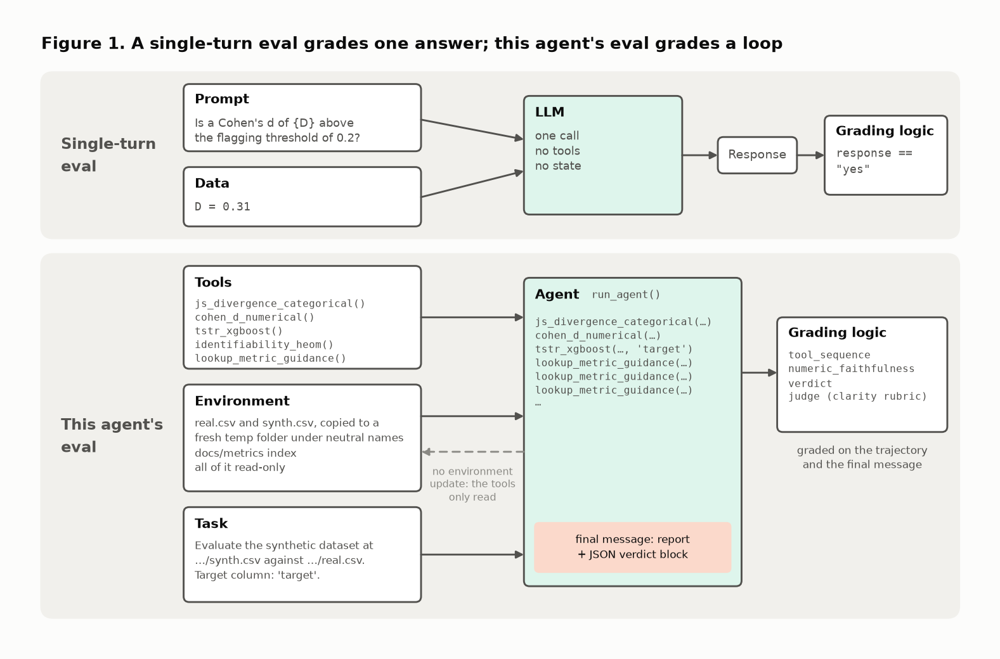
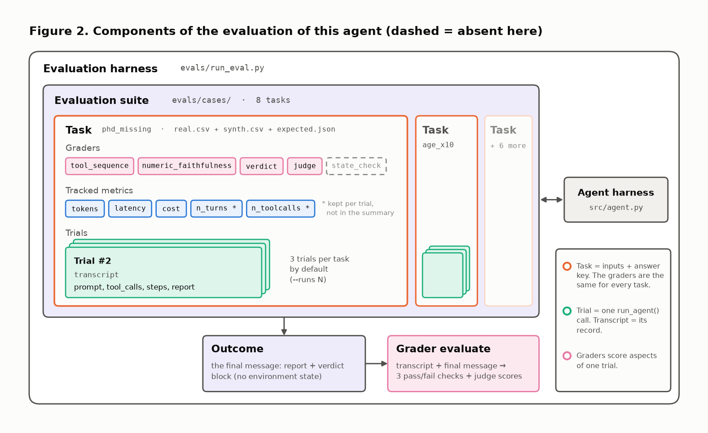
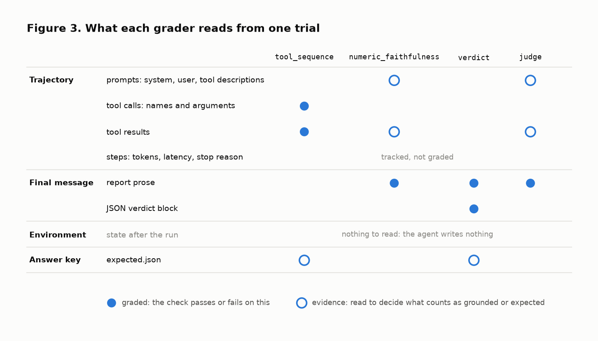
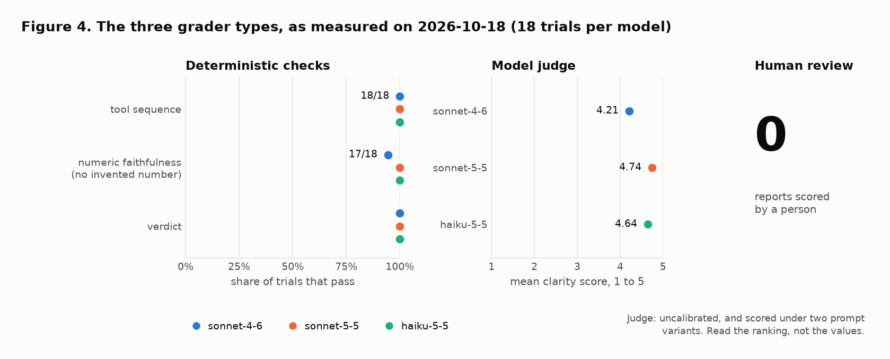
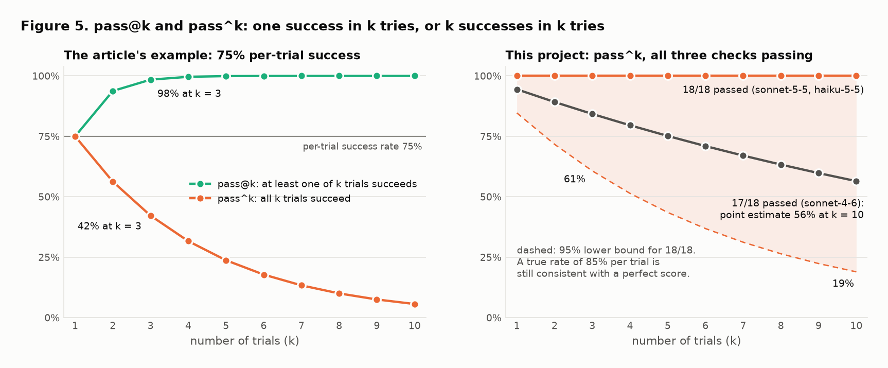
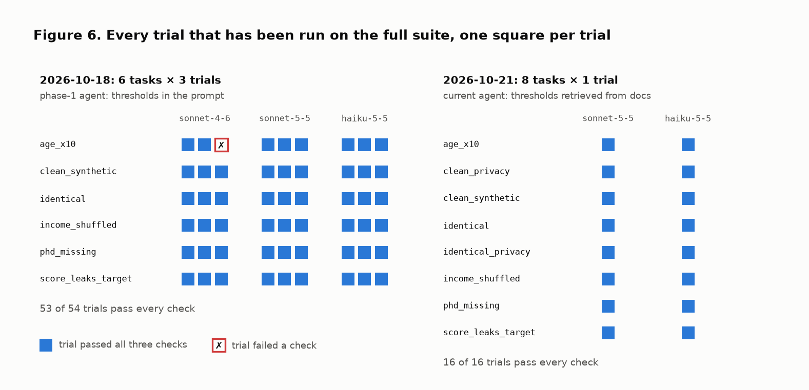
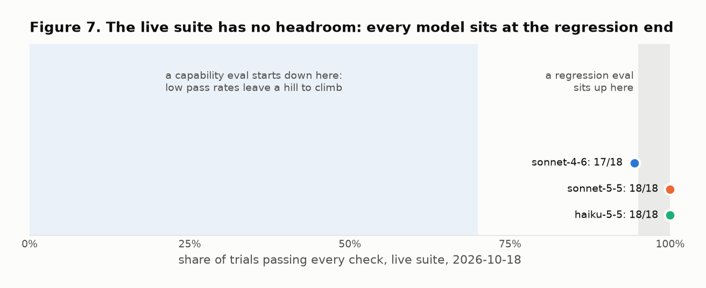
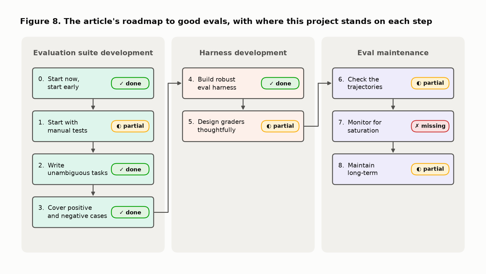
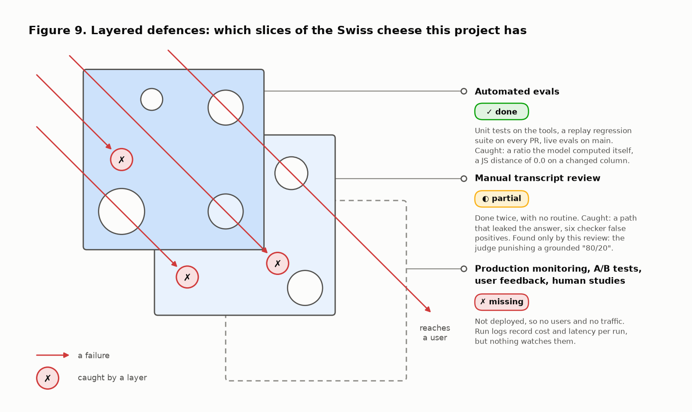

# Demystifying the evals of this agent

This note follows the deep dive [Anthropic: Demystifying evals for AI agents](https://ai-eval.org/deep-dive/anthropic-demystifying-evals-for-ai-agents) heading by heading, and under each heading explains the same idea with this repository's own evaluation harness instead of a generic example. The deep dive is a commentary on Anthropic's engineering article of 2026-01-09 ([original](https://www.anthropic.com/engineering/demystifying-evals-for-ai-agents)). The section titles below are the deep dive's. The five diagrams it borrows from the original article are redrawn here with this project's parts, and four more figures plot this project's own results.

It is written to be read on its own. Two companion notes go further:

- [eval_harness.md](eval_harness.md) explains the design of the harness from first principles, with the statistics and the references.
- [agent_evals_gap_analysis.md](agent_evals_gap_analysis.md) lists, section by section, what is still missing.

Every figure is generated by [figures/make_agent_eval_figures.py](figures/make_agent_eval_figures.py) from committed files only: the eval summaries under [../evals/results/](../evals/results/) and the answer keys under [../evals/cases/](../evals/cases/).

```
make figures          # or: python notes/figures/make_agent_eval_figures.py   (no API key needed)
```

**The agent in one paragraph.** [../src/agent.py](../src/agent.py) is a loop around Claude. You give it the path of a real CSV, the path of a synthetic CSV and a target column. It calls three metric tools (Jensen-Shannon distance per categorical column, Cohen's d per numerical column, a train-on-synthetic utility gap), a fourth privacy tool when asked, and a lookup tool that retrieves each metric's threshold from [../docs/metrics/](../docs/metrics/). It then writes a report that ends with a JSON verdict block.

**The evaluation in one paragraph.** Eight real/synthetic pairs are built so that the right verdict is known by construction. [../evals/run_eval.py](../evals/run_eval.py) runs the agent on each pair several times and applies three mechanical checks to every run (right tools, every number traceable, right verdict) plus a model judge for clarity. A separate pytest suite, [../regression/](../regression/), replays recorded failures through the same checks without calling the model.

## Why this matters

The article opens with the claim that evaluating an agent is a different job from evaluating a chat answer. An agent acts over several turns, uses tools, may change the outside world, and can fail in ways that stay invisible if you only read its last message. Its practical conclusion is to grade the task outcome and the state of the environment first, then read transcripts to understand why a result happened.

Two of those three properties apply here in full, and one does not:

| Property of agents | This agent |
|---|---|
| Acts over several turns | Yes. A run is two or three API calls: one that requests the tools, one that writes the report. |
| Uses tools | Yes. Six to nine tool calls per run in the current version. |
| Changes external state | No. Every tool only reads. The run produces text and nothing else. |



Figure 1 puts the two kinds of eval side by side. In the top row, a single question goes in, one answer comes out, and the grader compares it with the expected string. In the bottom row, the agent receives tools, an environment and a task, runs a loop, and only then produces a final message. The dashed arrow is the one place where this project differs from the article's picture: there is no environment update, because the tools never write.

The claim that failures hide behind a good final message is not hypothetical here. Three real cases from this repository:

- **A right number from the wrong place.** In an early run the report said that age had been scaled "by a factor of 10". The number was correct and so was the verdict. Nothing in any tool result says 10: the model had read it in the directory name `age_x10`. Only the trajectory shows that. The harness now runs every trial on a copy under a neutral name ([../evals/cases.py](../evals/cases.py)).
- **A right computation the agent was not allowed to make.** Claude Sonnet 4.6 quoted a Cohen's d of 4.909 correctly, then added that it was "more than 24 times the flagging threshold". The arithmetic holds. The figure is the model's own, and the agent is a reporter, not a calculator. The final verdict was right, so a verdict-only eval would have passed it.
- **A report that could have been written without the work.** A fluent report with plausible numbers can be produced without calling a tool. The tool-sequence check exists for that case: a tool that was never called makes its section of the report unsupported.

So the practical implication for this project is the article's, adapted: grade the verdict against a known answer, check the trajectory for what the final message cannot show, and read transcripts when a number moves.

## 1. Agent evals have more moving parts than prompt evals

A simple eval is a prompt, a response and a grader. That is enough when the behaviour under test is a single answer. An agent eval has more named parts, and the article lists eight of them. All eight exist in this repository:

| Term | Meaning | In this repository |
|---|---|---|
| Task | The problem and its success criteria | One folder under [../evals/cases/](../evals/cases/): `real.csv`, `synth.csv` and `expected.json` (expected tools, verdict per axis, flagged columns). Eight tasks. |
| Trial | One stochastic attempt at a task | One call of `run_agent()` on a fresh neutral copy of the task. `--runs N` sets the number, three by default. |
| Agent harness | The scaffold that runs the loop and the tools | [../src/agent.py](../src/agent.py): the loop, the tool registry, the system prompt. |
| Eval harness | What runs, records, grades and aggregates trials | [../evals/run_eval.py](../evals/run_eval.py), with [../evals/cases.py](../evals/cases.py), [../evals/checks/](../evals/checks/) and [../evals/compare.py](../evals/compare.py). |
| Transcript | The record of a trial | One JSON file per trial under `evals/results/<run>/transcripts/`: prompt, tool calls with inputs and results, per-step tokens and latency, the report, the scores. |
| Outcome | The final state of the world | For this agent, the final message: the report and its JSON verdict block. There is no other state. |
| Grader | Logic that scores one aspect of a trial | Three deterministic checks and one model judge. |
| Suite | A collection of related tasks | The eight tasks, as one suite. |



Figure 2 is the article's component diagram with this project's names. Read it from the inside out. A trial produces a transcript. Trials stack under a task. Tasks sit in the suite. The eval harness wraps the suite and talks to the agent harness, which is a separate piece of code. Under the suite, the outcome feeds the graders, which turn a transcript and a final message into scores. Two things are marked as different from the article's picture. The `state_check` grader is dashed because there is no state to check. Two tracked metrics carry an asterisk because they are recorded per trial but not rolled up into the summary.

### One trial, step by step

This is what `run_eval.py` does for one trial, with the values of a recorded trial of Claude Sonnet 5.5 on the task `phd_missing` (2026-10-21):

1. **Copy the task to a neutral folder.** The prompt will contain file paths, and a path like `evals/cases/phd_missing/` gives the answer away.
2. **Build the prompt** from one template: evaluate the synthetic file against the real file, with the target column named.
3. **Call the agent harness.** In this trial the first API call requested six tools at once (three metrics, three threshold lookups) and took 3.7 s. The second wrote the report and took 5.9 s.
4. **Separate plumbing failures from model failures.** API errors, truncation, refusals and the turn limit are logged apart and excluded from the pass rates.
5. **Run the three checks.** The tools were the expected ones on the right files. Every number in the report traced to a tool result. The verdict block said `acceptable` with `education` flagged, which is what `expected.json` says.
6. **Run the judge**, which scores clarity on five criteria.
7. **Write the transcript and, at the end, the summary.**

| What one trial costs (current agent, 2026-10-21) | Sonnet 5.5 | Haiku 5.5 |
|---|---|---|
| API calls | 2 | 2 to 3 |
| Tool calls | 6 to 9 | 6 to 9 |
| Input tokens | 10k to 12k | 13k to 16k |
| Latency | 9 to 14 s | 9 to 13 s |
| Estimated cost at list price | about $0.04 | about $0.003 |

### Transcript versus outcome

The article singles out one distinction as the most useful: the transcript is what the agent said and did, the outcome is what is true afterwards. Its example is a flight agent that announces a booking while the database holds no reservation.

This agent books nothing, so where is its database? The agent makes a claim about data: "this synthetic file is acceptable, and `education` is the problem". The thing that is true or false is the data itself. Each task is built so that the truth is known: in `phd_missing`, every `phd` was relabelled `master`, so one categorical level is missing and nothing else changed. `expected.json` plays the role of the database row. Comparing the verdict with it is this project's outcome check, even though what is read is text.

## 2. The right grading target is usually the outcome, not the text

The article's strongest advice is to prefer checks on outcome or state. For a coding agent that means tests pass and files changed correctly. For a support agent, the refund record exists. For a data agent, the query result and the side effects match expectations. Checks on the final answer stay useful but are weaker, because an agent can claim completion falsely or reach the result by an unexpected path.

The closest of those examples is the data agent. The equivalent line for this project would read: **the verdict and the flagged columns match what is true of the data, and every number in the report is a number a tool returned.**



Figure 3 shows what each grader reads from one trial. A filled dot means the check passes or fails on that field. A ring means the field is read as evidence, to decide what counts as grounded or expected.

- **`tool_sequence`** is graded on the trajectory. It fails when an expected tool was never called, when a tool was called twice, when a tool ran on the wrong file or target, or when a tool returned an error. Order is not asserted, because the three metric tools are independent.
- **`numeric_faithfulness`** is graded on the report prose. Every number in it must match a number in a tool result or in the text the agent was shown. The trajectory is the evidence.
- **`verdict`** is graded on the JSON verdict block, against the answer key. It also requires every flagged column to be named in the prose.
- **`judge`** is graded on the report prose, with the tool results as facts.
- **The environment row is empty.** Nothing reads state after the run, because there is none.

So the grading target is the final message, with the trajectory as evidence. By the article's taxonomy that is a final-answer check. The two weaknesses the article attaches to final-answer checks are both handled:

| Weakness named by the article | What stops it here |
|---|---|
| The agent claims work it did not do | `tool_sequence` fails a missing tool. `numeric_faithfulness` fails any number that no tool returned. |
| The agent reaches the result by an unexpected path | Tool order is free. Only the set of tools, their files and their target are checked. |

The article closes the section with a judgment: a demo eval asks whether the answer sounded right, a production eval asks whether the system did the job safely and correctly. In this harness only the judge asks whether the report reads well, and the judge never decides a pass. The three checks ask whether the job was done correctly, against ground truth. The word "safely" is the part that is not covered: no task tries to mislead the agent.

Because the target is text, the text can drift from the graded answer in a few known ways. They are listed, with reproductions, in the [gap analysis](agent_evals_gap_analysis.md#2-the-right-grading-target-is-usually-the-outcome-not-the-text).

## 3. Use multiple grader types because each fails differently

The article describes three kinds of grader and what each is bad at. Deterministic graders are fast, stable and cheap, but reject valid answers when the test is too narrow. Model-based graders handle open-ended output, but need calibration because a judge can drift, be biased, or reward reasoning that is plausible and wrong. Human graders are expensive, but are the reference for subjective quality and for calibrating judges.



Figure 4 shows the three types as measured on the one session that ran three trials per task (2026-10-18, six tasks, eighteen trials per model).

### Deterministic graders: the three checks

They live in [../evals/checks/](../evals/checks/) and call no model. That is what makes the regression suite possible: 55 tests replay recorded and constructed reports through the same three functions in about six seconds.

Both failure directions have been observed.

- **Too narrow.** The first live session flagged eight numbers across 54 trials. Reading them showed that six were the checker's fault. The model wrote "0 = identical, 1 = completely different", which is true of the JS distance, but nobody had told it the scale, so "1" counted as invented. It wrote "21 percentage points" for a gap of 0.215, and the checker did not read "percentage points" as a percent sign. Both were fixed at the source: the tool description now states the range, and percentage words are parsed.
- **Too loose.** A number written in words is not seen as a number, and a prose verdict that contradicts the verdict block is not compared with it. Both are in the gap analysis.

Two rules are narrow on purpose. A correct ratio that the model computed itself fails, and a tool called twice fails. Each mirrors a rule in the agent's prompt, so what is rejected is rule-breaking, not creativity.

### Model-based grader: the judge

[../evals/checks/judge.py](../evals/checks/judge.py) asks a second model to score five criteria from 1 to 5: the verdict comes first, flagged columns are explained with value and threshold, each metric gets a one-sentence explanation, the caveats that matter are present, and nothing is overclaimed. The role is the one the article assigns: clarity has no ground truth, so a judge scores it and nothing else.

Four mitigations are built in. The judge is a different model from the one under test. The report is wrapped in tags and the judge is told to treat it as data and not to reward length. The rubric text is hashed and the hash is stored with every score. The score is a comparison number, never a gate.

The judge has been wrong in ways that show why the article insists on calibration:

- It counted "XGBoost" as an invented detail, until it was given the tool descriptions the agent had read.
- It counted "80/20 split" as invented in two Haiku reports. The split is stated in a tool's parameter description, which the numeric check reads and the judge does not.
- On the task `identical`, a Haiku report warned that results this good suggest the file is a copy and recommended a privacy check. The judge scored it 2 out of 5 for overclaiming. Whether that warning is an overclaim or the most useful sentence in the report is a judgment call, and no human label exists to settle it.

### Human graders

None yet. A person wrote the eight answer keys and read the flagged transcripts twice. Nobody has scored a report by hand, so nothing measures how far the judge agrees with a human reader. That is the "0" in Figure 4.

### The practical pattern

| The article's pattern | Here |
|---|---|
| Deterministic checks for hard correctness and state | Three checks for correctness. No state exists. |
| Model judges for qualitative dimensions | One judge, for clarity only. |
| Periodic human review to calibrate both | Not done. |
| Read transcripts when aggregate numbers move | Done twice. It found the six false positives above and the one real failure. |

## 4. Non-determinism means one run is not enough

The same prompt gives a different report on every run. Newer models do not accept a custom temperature, so the variance cannot be switched off. It has to be measured by repetition. The article highlights two ways to summarise repeated trials. With a per-trial success rate `p` and independent trials:

- **pass@k** is the probability that at least one of k trials succeeds: `1 − (1 − p)^k`. It rises with k.
- **pass^k** is the probability that all k trials succeed: `p^k`. It falls with k.



The left panel of Figure 5 is the article's worked example. At a 75% per-trial rate, three tries almost guarantee one success (98%) and give all three successes less than half the time (42%). A model can look capable and still be unreliable.

### Which one is this product's question

pass@k fits a product where one success is enough and retries are cheap. pass^k fits a product where consistency is part of what is sold.

This agent's verdict feeds a decision: use the synthetic dataset or not. A person runs it once and acts on it. Nobody runs it three times and keeps the best report, and without ground truth nobody could tell which report is best. So the question is pass^k: if the same file is evaluated again, does the same correct verdict come back?

### What the harness reports, and what the numbers allow

`run_eval.py` reports a pass rate per check, the share of trials that pass all three, and a noise floor of about `1/√n`. It does not report pass^k. The right panel of Figure 5 computes it from the committed summaries.

- **Sonnet 5.5 and Haiku 5.5 passed 18 of 18 trials.** The point estimate of pass^k is 100% for every k. That is not the same as knowing it. With eighteen trials and no failure, a true per-trial rate of 85% is still consistent with the result at the 95% level. At that rate pass^3 is 61% and pass^10 is 19%. The shaded band is everything the data allows.
- **Sonnet 4.6 passed 17 of 18.** The point estimate is 84% at k = 3 and 56% at k = 10.

One assumption sits under both: the eighteen trials are pooled across six tasks, as if every trial had the same chance of passing. Per task there are only three trials.



Figure 6 shows every trial behind those numbers, one square each. The left panel is the session with three trials per task, run on the first version of the agent, when the thresholds were still written in the prompt. The right panel is the only session that covers all eight tasks on the current agent, which retrieves its thresholds: one trial per task, two models. For the agent as it ships today, reliability has been measured at k = 1.

```
make eval MODEL=claude-sonnet-5-5 RUNS=5      # five trials per task, judge on
make eval-nojudge MODEL=claude-haiku-5-5 RUNS=5
make compare                                  # one row per saved results folder
```

## 5. Split capability evals from regression evals

The article separates two questions. A capability eval asks whether the agent can do this kind of task yet. It should contain hard tasks and should not sit near 100%, because a low pass rate is what leaves room to measure improvement. A regression eval asks whether something that used to work has broken. It should be stable, fast, and tied to real failures. Keeping them apart prevents a common mistake: turning every eval into a release gate.

This repository has the split in its folder structure.

| | `evals/` | `regression/` |
|---|---|---|
| Question | How good is the agent now? | Did a known failure come back? |
| Calls the model | Yes, N trials per task | Never |
| Result | Pass rates | Plain pytest pass or fail |
| Runs | On `main`, and by hand when the prompt, tools or model change | On every pull request, about six seconds |
| Cost | API calls and minutes | Free |

`regression/` is a regression eval in the article's sense: eleven test files, each named after the failure it pins. The two sides are drawn next to each other in Figure 7 of [eval_harness.md](eval_harness.md). A failure moves from one side to the other by record and replay. The computed-ratio failure is the worked example:

1. The live eval of 2026-10-18 flagged the number `24` in one Sonnet 4.6 trial on `age_x10`.
2. Reading the transcript showed the sentence "more than 24 times the flagging threshold".
3. The transcript was copied to [../regression/fixtures/age_x10_computed_ratio.json](../regression/fixtures/age_x10_computed_ratio.json).
4. [../regression/test_no_computed_ratio.py](../regression/test_no_computed_ratio.py) replays it and asserts that the check still catches it.

### Is `evals/` a capability eval?

By the article's definition, not at the moment.



Figure 7 places each model's pass rate on the scale the article describes. A capability eval starts on the left, with a hill to climb. A regression eval sits on the right. All three models sit at the right edge: 17, 18 and 18 trials out of 18. The current agent passed 16 of 16.

The reason is how the tasks are built. Each one applies a single clean corruption. The thresholds are retrieved, and the verdict rules are mechanical. A model that follows instructions passes. That makes the live suite a live regression check: it tells you whether a new model or a prompt change breaks behaviour that works. It does not tell you how much better one model is than another, because nothing in it is hard.

A capability task for this agent would be one where following the rules is not enough. A column whose mean is unchanged but whose shape is not. Two corruptions at once. A value that sits just under a threshold. A request that does not name the target column. A file where half the rows are copies.

### What gates, and what informs

The regression suite gates every pull request. The live eval informs: on `main` it runs once per task on the cheapest model, writes its table to the job summary, and exits successfully whatever the pass rates are. That matches the article's point that not every eval should block a release. The other half of the point, that some should, has no live counterpart yet.

### The roadmap

The original article ends with a roadmap of nine steps in three stages. The deep dive shows it under this section.



| Step | Where this project stands |
|---|---|
| 0. Start early | Done. The harness was the first phase of the v2 work, before the service and the container. |
| 1. Start with manual tests | Partial. The tasks are constructed, and three observed failures became fixtures. No task comes from real usage, because there are no users yet. |
| 2. Write unambiguous tasks | Done. The answer is known by construction. An oracle report must pass every check, and a test confirms that each answer key agrees with the rules applied to real tool output. |
| 3. Cover positive and negative cases | Done. Verdicts split three excellent, two acceptable, three poor. Two tasks expect a flagged column and six expect none, including two where utility is poor and no column may be blamed. The privacy tool must run when asked and must not run otherwise. |
| 4. Build a robust harness | Done. Each trial gets a fresh copy, the tools only read, the train/test split is seeded, and plumbing failures are counted apart. |
| 5. Design graders thoughtfully | Partial. Deterministic first, a judge only for clarity, order not asserted, partial credit on numbers. The judge is uncalibrated and has no "cannot tell" option. |
| 6. Check the transcripts | Partial. Done twice with real findings. No routine. |
| 7. Monitor for saturation | Missing. The suite is saturated and nothing reports it. |
| 8. Maintain long-term | Partial. A changelog, a rubric hash and a consistency test exist. Results are not stamped with the version of the agent that produced them. |

## 6. Evals are one layer, not the whole safety net

The article argues for layers: automated evals, production monitoring, A/B tests, user feedback, transcript review and human studies. Each catches failures the others miss. It compares this to the Swiss cheese model from safety engineering: every slice has holes, and stacking slices makes it unlikely that a failure passes through all of them.



Figure 9 redraws that picture for this project. The first slice is solid, the second is thin, and the third is an outline, because the service has never been deployed.

| Layer | What it is good at | In this project |
|---|---|---|
| Automated evals | Fast, repeatable, run before any user is affected | In place: unit tests on the tools, the replay suite on every pull request, live evals on `main`. |
| Manual transcript review | Builds intuition, catches subtle quality problems | Ad hoc. Done twice, after the first live sessions. |
| Production monitoring | Shows real behaviour at scale | Absent. Each run logs its trace, tokens, latency and cost under `runs/`, but there is no deployment and nothing watches the logs. |
| A/B tests | Measure real outcomes on real traffic | Absent. Models are compared offline only. |
| User feedback | Surfaces problems nobody anticipated | Absent. No users, and no feedback field in the API. |
| Human studies | Reference judgments, used to calibrate judges | Absent. |

What each layer actually caught is the best argument for having more than one:

- **Known-answer unit tests on the tools** caught a bug no report would reveal: a category present only in the synthetic file was dropped, and the JS distance came out as exactly 0.0 for a visibly different column.
- **The live eval** caught the computed ratio.
- **Reading transcripts** caught the leaked path, and caught the checker's own false positives, which the pass rate alone presented as model failures.
- **Nothing in place** can catch a file shape nobody thought of, because that takes real users.

## What I would reuse from this article

The deep dive condenses the article into a checklist of eight items for any agent project. Applied here:

| # | Checklist item | How this project does it | Status |
|---|---|---|---|
| 1 | Define the task in terms of user-visible success | Success is a correct verdict, the right flagged columns and no invented number. The verdict is checked in the JSON block, not in the sentence the user reads first. | Partial |
| 2 | Make the environment resettable and isolated | A fresh neutral copy per trial, read-only tools, a seeded split, run logging switched off. | Done |
| 3 | Grade state and outcome first, final text second | There is no state. The verdict is graded against ground truth, which is the nearest equivalent. | Partial |
| 4 | Store transcripts for every trial | One JSON per trial, written locally. They are git-ignored and do not hold the raw message list. | Partial |
| 5 | Run multiple trials and report capability and reliability | Three trials by default and a noise floor. No pass^k, and one trial per task on the current agent. | Partial |
| 6 | Keep a regression suite separate from capability evals | The regression suite is separate and strong. The other side has no hard tasks. | Partial |
| 7 | Sample transcripts regularly, especially after score changes | Done after the two first sessions, not on a schedule. | Missing |
| 8 | Treat evals like product infrastructure | Changelog, CI, rubric hash, consistency test. No version stamp on results, and the judge rubric has fallen behind the agent. | Partial |

## Main caveat

The deep dive notes that the article is strongest on method and leaves three decisions to each team: which state matters, how much non-determinism is acceptable, and where a model judge is reliable enough. It adds that the hard part is designing outcome checks that match real user value without overfitting to a brittle path. Here is where this project stands on each.

**Which state matters.** None exists, so the choice was to make the truth about the data the thing that is checked, and to know that truth by construction. The limit is in the word construction. All eight tasks come from one generative process with seven columns and two thousand rows. The agent has also been run on real generator outputs (CTGAN, TVAE and an LLM baseline on three public datasets), where its verdict agreed with the mechanical flags on nine outputs out of nine. That comparison is a one-off script, not part of the suite.

**How much non-determinism is acceptable.** Not decided. No file says "this agent ships if pass^3 is at least some value". The harness reports a noise floor so that small differences are not over-read, which is the honest half of the answer.

**Where the judge is reliable enough.** Only for ranking models on clarity, and it is used for nothing else. The three examples in section 3 show that its individual scores should not be trusted yet.

**Outcome checks and brittle paths.** Two choices here lean toward the brittle side, and both are deliberate. The tool-sequence check requires each metric tool exactly once, so a legitimate second call would fail. The verdict rules are mechanical, so the verdict check measures whether the agent applies documented rules to tool output. It does not measure whether those rules capture what makes synthetic data good. That second question belongs to the thesis behind the metrics, not to this harness.

## Bottom line

The deep dive's last line reframes agent evals as systems tests: the unit under test is the model plus the harness, the tools, the memory, the environment and the product assumptions.

This repository's history supports that reading. Of the failures the evaluation work has found, most were not the model's:

| Failure | Where the fault was |
|---|---|
| JS distance of 0.0 on a changed column | A tool |
| "Factor of 10" read from a folder name | The eval environment |
| Six of eight flagged numbers in the first session | The checker and a tool description |
| "XGBoost" and "80/20" scored as invented | The judge's context |
| "More than 24 times the threshold" | The model |

The clearest example is the change that moved the thresholds out of the prompt and into retrieved documentation. No model changed. The prompt, a tool, an index and five documentation pages did. The eval is what showed that the system as a whole still produced eight right verdicts out of eight on two models, and a regression test now fails if the documentation, the agent and the checker ever disagree.

The boundary of the system under test is also worth stating. Inside it: the model, the loop, the five tools, the metric pages, the retrieval index, the prompt and the verdict rules. Outside it, and covered only by tests with a scripted fake model: the HTTP service, the upload validation, the run log and the container.
