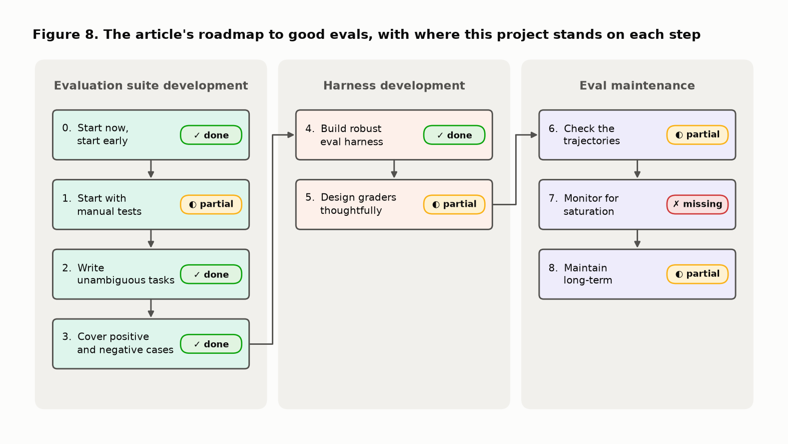

# Agent evals: gap analysis against "Demystifying evals for AI agents"

This note takes each section of the deep dive [Anthropic: Demystifying evals for AI agents](https://ai-eval.org/deep-dive/anthropic-demystifying-evals-for-ai-agents) and lists what this project's evaluation of its agent is still missing against it. The deep dive is a commentary on Anthropic's article of 2026-01-09 ([original](https://www.anthropic.com/engineering/demystifying-evals-for-ai-agents)), which was read as well, for the figures and the nine-step roadmap.

- **State compared:** commit `7ba0776`, on 2026-11-10.
- **Update, 2026-11-11:** three items below have moved since. G5: new sessions record the commit, the tool count and a hash of the system prompt in `summary.json`, and [../results/agent_evals.md](../results/agent_evals.md) labels every row with the agent it measured (a hash of the task set is still missing). G16: the README table is now generated from `summary.json`, so the two no longer disagree, and the two rows scored under the first judge prompt are marked; the re-scoring itself is still to do. G31: the README status line and the Makefile header are fixed, and [eval_harness.md](eval_harness.md) states its scope; `mypy` still checks `src` only. The rest of the note stands as written.
- **Method:** the code under [../evals/](../evals/), [../regression/](../regression/), [../src/](../src/) and the CI workflow was read, the committed eval summaries and the local transcripts were inspected, and three suspected holes in the graders were run against the real checkers. The reproduction is in the [appendix](#appendix-reproducing-the-three-probes).
- **Companion:** [agent_evals_explained.md](agent_evals_explained.md) explains the same sections with figures. This note only lists gaps.

Each gap has an identifier (G1 to G31), the evidence for it, and the smallest change that would close it. A gap that matters to several sections is described once and referred to by its identifier afterwards.

## Summary

| Section of the deep dive | Status | Biggest gap |
|---|---|---|
| Why this matters | Partial | Transcript review has no routine (G2) |
| 1. More moving parts than prompt evals | Mostly done | Results carry no version of the agent that produced them (G5) |
| 2. Grade the outcome, not the text | Partial | The verdict a user reads is not the verdict that is graded (G9) |
| 3. Multiple grader types | Partial | The judge is uncalibrated and its rubric is out of date (G13, G14) |
| 4. One run is not enough | Partial | The current agent has one trial per task (G19) |
| 5. Capability versus regression | Partial | No task is hard, so there is no capability eval (G22) |
| 6. One layer, not the whole net | Mostly missing | No production layer of any kind (G26) |
| What I would reuse (8-item checklist) | 1 done, 6 partial, 1 missing | Item 7, regular transcript sampling |
| Main caveat | Open decisions | No written reliability target (G21) |
| Bottom line | Partial | The served path is outside the evaluated system (G7) |



## Why this matters

**What the section asks.** Treat the agent as something that acts over several turns, uses tools and may change state. Grade the outcome and the environment state, then use transcript review to understand why.

**What the project already has.** The eval runs the whole loop, not a single call. The trajectory is checked (which tools, on which files). Three real failures that a final-answer check would have passed were caught this way.

**Gaps.**

- **G1. There is no environment state to grade.** The tools only read, and the eval runner switches run logging off ([run_eval.py:79](../evals/run_eval.py#L79)), so a trial leaves nothing behind. This is a property of the agent, not a defect, and it needs no fix today. It becomes a gap the day the eval exercises anything that writes: the saved report, the run folder, the API response. *Fix when that happens:* a check that reads what was written, not what the report says.
- **G2. Transcript review is not a practice, it is two events.** Transcripts were read after the two first live sessions (2026-10-18), and that reading found six checker false positives and one real failure. Nothing has prompted a reading since. This review found a judge error that had been sitting in saved transcripts since 2026-10-21 (G15). *Fix:* a `make review` target that prints, for the latest results folder, every trial whose lowest judge score is 3 or less together with the judge's rationale, and a habit of running it after each `make eval`.

## 1. Agent evals have more moving parts than prompt evals

**What the section asks.** Name and build the parts: task, trial, agent harness, eval harness, transcript, outcome, grader, suite. Keep transcript and outcome apart.

**What the project already has.** All eight parts exist and are separate pieces of code. Trials are isolated: each runs on a fresh copy under a neutral name.

**Gaps.**

- **G3. The transcript is not the full record.** A saved trial holds the prompt, the tool calls with results, per-step token and latency figures, and the report. It does not hold the message list, so any text the model wrote between tool calls is lost. `AgentRun.messages` carries it and is simply not written. A trial that fails for a plumbing reason keeps even less: only the report and the usage ([run_eval.py:92](../evals/run_eval.py#L92)). *Fix:* add `messages` to the record in `score_one`, and keep `tool_calls` on failed trials.
- **G4. Transcripts are not preserved.** `.gitignore` excludes `evals/results/*/transcripts/`, so they exist only in this workspace. CI uploads them as an artifact that expires after 30 days. This project has already lost unpushed work once, which is why two of the three replay fixtures are reconstructions (G25). *Fix:* commit the transcripts of any session whose numbers are quoted in the README, or archive each results folder as a release asset.
- **G5. A result does not say which agent produced it.** `summary.json` records the model, the judge and a hash of the judge rubric. It records no git revision, no hash of the system prompt, and no hash of the task set ([run_eval.py:140](../evals/run_eval.py#L140)). The session of 2026-10-18 ran an agent with the thresholds in its prompt, and the session of 2026-10-21 ran one that retrieves them. `make compare` prints both in one table with nothing to tell them apart. The figure script for these notes had to hard-code the mapping from results folder to agent version by reading the changelog. *Fix:* add `git_revision`, `system_prompt_sha` and `cases_sha` to the summary, and a column for the first in `compare.py`.
- **G6. Tasks carry no metadata, and the graders are the same for every task.** `expected.json` holds the answer key. It has no field for the kind of task, its difficulty, or whether it is meant as a capability or a regression task. All eight tasks also use one prompt template ([cases.py:22](../evals/cases.py#L22)), so the suite never varies how the request is worded. *Fix:* a `tags` list in `expected.json` and an optional `prompt` override per task.
- **G7. The eval calls `run_agent()` directly, not the service.** The upload validation, the error mapping and the run-log writer are therefore never exercised with a live model. They are covered by API tests with a scripted fake. The prompt template is also written twice, in `evals/cases.py` and `src/api.py`. The two copies are identical today and no test pins that. *Fix:* import the template from one place, and add an option to run a trial through `POST /evaluate`.
- **G8. Two tracked metrics stop at the transcript, and latency has no tail.** The number of turns and of tool calls are in each trial's `steps` and never reach the summary. Latency is reported as a mean only ([run_eval.py:205](../evals/run_eval.py#L205)). There is no cost cap on a session. *Fix:* add the median and maximum of turns, tool calls and latency to `summarise`, and a `--max-cost` guard.

## 2. The right grading target is usually the outcome, not the text

**What the section asks.** Prefer checks on state and outcome. Treat final-answer checks as weaker, because an agent can claim completion falsely or take an unexpected path. Ask whether the system did the job safely and correctly, not whether the answer sounded right.

**What the project already has.** The verdict is compared with ground truth known by construction. A tool that was never called fails the trial, and so does a number no tool returned, so the agent cannot claim work it did not do. Tool order is free.

**Gaps.**

- **G9. The verdict a person reads is not the verdict that is graded.** `check_verdict` reads the JSON block at the end of the report and confirms that flagged columns are named in the prose ([verdict.py:133](../evals/checks/verdict.py#L133)). It does not compare the verdict stated in the first lines with the block. Probe (a) in the appendix changes an oracle report's opening from "Overall verdict: poor" to "Overall verdict: excellent" and leaves the block alone. The check passes. *Fix:* extract the overall verdict word from the first lines of the prose and require it to equal the block. Add the probe as a regression test first.
- **G10. A number written in words is not seen.** `numeric_faithfulness` finds numbers by a pattern on digits ([common.py:13](../evals/checks/common.py#L13)). Probe (b) adds the sentence that was the suite's one real failure, "more than 24 times the flagging threshold", and it is caught. The same sentence with "twenty-four" passes, and so does "roughly double". *Fix:* a short list of number words and multipliers (double, twice, half, a third, tenfold, spelled-out integers) treated as ungrounded unless a tool result supports them.
- **G11. An unsupported claim without a number is invisible to the deterministic checks.** A Haiku report on the task `identical` said the synthetic rows probably contain the real rows and that privacy risk is high, without having run the privacy tool. All three checks passed. Only the judge reacted, and the judge never decides a pass. Whether that sentence is an overclaim or a useful warning is itself unsettled (G13). *Fix:* none that is cheap and mechanical. This is what a calibrated judge is for.
- **G12. "Safely" is not graded.** No task tries to mislead the agent: no instruction hidden in a column name or a cell, no path argument pointing outside the task folder, no request to skip a tool. *Fix:* three to five adversarial tasks, with the expected behaviour stated in `expected.json`.
- **G1** applies here too: nothing reads state, because none exists.

## 3. Use multiple grader types because each fails differently

**What the section asks.** Deterministic checks for hard correctness. A model judge for qualitative dimensions, calibrated because judges drift and can be biased. Periodic human review to calibrate both. Read transcripts when the aggregate numbers move.

**What the project already has.** Three deterministic checks, used for correctness and replayed offline by 55 regression tests. One judge, used for clarity only, on a different model, with the report passed as data, a hashed rubric, and no power to fail a trial.

**Gaps.**

- **G13. The judge has never been compared with a human.** No report has been scored by hand, so there is no agreement figure of any kind. The README says so. Until this exists, the clarity column supports a ranking of models and nothing finer. *Fix:* score 20 to 30 saved reports yourself on the five criteria, blind to the judge's scores, and report agreement per criterion.
- **G14. The judge rubric describes an older agent.** The rubric text says the report uses three metrics and hard-codes their thresholds ([judge.py:41](../evals/checks/judge.py#L41)). The agent now has a fourth metric, privacy, and takes every threshold from the documentation. A regression test pins the documentation, the agent and the verdict checker to each other. Nothing pins the judge. *Fix:* build the rubric's metric sentence from `guidance.thresholds()`, mention the privacy axis when it was assessed, and add the judge to `test_thresholds_come_from_docs.py`.
- **G15. The judge is shown less than the numeric check is.** The numeric check counts as grounded anything in the tool descriptions and the parameter descriptions. The judge receives the tool descriptions only ([run_eval.py:38](../evals/run_eval.py#L38)). The phrase "split 80/20 internally" is in a parameter description ([agent.py:210](../src/agent.py#L210)). In the session of 2026-10-21 the judge called "80/20 split" an invented fact in two Haiku reports and lowered the overclaim score to 3 and to 2. The numeric check, correctly, had let it through. *Fix:* build the judge's context from the same text as `TOOL_DESCRIPTIONS`.
- **G16. The saved clarity scores were produced under two judge prompts.** After the first session the judge was given the agent's context. Sonnet 4.6 was re-scored under the new prompt. Haiku 5.5 and Sonnet 5.5 were not, because the API credit ran out, and their transcripts still carry the error. The README table and `summary.json` therefore disagree for Sonnet 4.6 (3.96 and 4.21). *Fix:* `python -m evals.run_eval --rejudge` on the two remaining folders, then update the README table.
- **G17. The judge cannot say it does not know, and it is alone.** The score schema forces an integer from 1 to 5 on every criterion. One judge model is used, from the same family as the agent. *Fix:* allow a null score with a reason. A second judge is optional and only worth it after G13.
- **G2** applies here: the fourth practice in the section, reading transcripts when numbers move, has no routine.

## 4. Non-determinism means one run is not enough

**What the section asks.** Run several trials. Report pass@k when one success is enough and pass^k when consistency is the product. Do not mistake a capable model for a reliable one.

**What the project already has.** A `--runs` option, three by default. Pass rates instead of booleans. A printed noise floor, so that small differences between models are not over-read. Per-task pass counts in the summary.

**Gaps.**

- **G18. Neither pass@k nor pass^k is reported.** The summary pools trials across tasks into one rate per check. For an agent whose verdict feeds a decision, the product question is pass^k: does the same file get the same right verdict every time? The per-task counts needed to compute it are already in `per_case`. *Fix:* add to `summarise` the share of tasks whose trials all passed, and a lower confidence bound on the pooled rate.
- **G19. The agent as it ships has been measured at one trial per task.** The only session that covers all eight tasks on the current agent ran one trial each on two models: 16 trials. The session with three trials per task predates the privacy tool and the retrieved thresholds, and covers six tasks. The two privacy tasks have never had more than two trials in one session. CI also runs one trial per task ([ci.yml:61](../.github/workflows/ci.yml#L61)). Eighteen passes out of eighteen still allow a true per-trial rate of 85% at the 95% level, which is a pass^3 of 61%. *Fix:* one session of five trials per task on each model. At the recorded cost per trial that is about $1.50 for Sonnet 5.5 and about $0.10 for Haiku 5.5, before the judge.
- **G20. The default model has not been run on the current agent.** `DEFAULT_MODEL` is `claude-sonnet-4-6` ([agent.py:40](../src/agent.py#L40)). It is also the service's default and the Makefile's. The two sessions of 2026-10-21 ran Sonnet 5.5 and Haiku 5.5 only. The one model a caller gets without asking is the one with no result on the five-tool agent. *Fix:* include it in the session of G19, or change the default to a model that has been measured.
- **G21. No reliability target is written down.** Nothing states what pass^k the agent must reach to be used, so no session can be said to pass or fail. *Fix:* a small `eval_thresholds.yaml` (for example verdict pass^3 of 1.0 on the regression-grade tasks, no invented number in at least 95% of trials), read by the runner.

## 5. Split capability evals from regression evals

**What the section asks.** Keep two kinds of eval. Capability evals contain hard tasks and should not sit near 100%. Regression evals are stable, fast and tied to real failures. Do not turn every eval into a release gate.

**What the project already has.** A real regression suite: eleven files, 55 tests, no model call, about six seconds, on every pull request, each file named after the failure it pins and documenting where the failure came from. A template for adding a new one.

**Gaps.**

- **G22. There is no capability eval.** Every model passes every task: 53 of 54 trials on the first agent, 16 of 16 on the current one. Each task applies one clean corruption, the thresholds are retrieved and the verdict rules are mechanical, so following instructions is enough. The live suite therefore behaves as a live regression check. It cannot show that one model is better than another. *Fix:* five to ten tasks where the rules are not enough. Candidates: a column with the same mean and a different shape, two corruptions at once, a value just under a threshold, a request that does not name the target, half the rows copied from the real file, a tool that returns an error, real generator outputs from [../data/generators/](../data/generators/). Keep them out of any gate.
- **G23. Nothing watches for saturation.** A suite at 100% gives no signal of improvement, and the summary does not say so. *Fix:* one line in `summary.md` when every task passes every trial: "suite saturated, add harder tasks".
- **G24. No live result can fail a build.** `run_eval.main` returns 0 whatever the pass rates ([run_eval.py:349](../evals/run_eval.py#L349)). On `main`, a model that got every verdict wrong would produce a table in the job summary and a green tick. The article's point is that not every eval should gate. Here no live eval does, including the saturated tasks that are regression checks in all but name. *Fix:* exit non-zero when a regression-grade task misses the thresholds of G21, and keep capability tasks informational.
- **G25. One of the three replay fixtures is a real recording.** `age_x10_computed_ratio.json` was recorded live. The other two were rebuilt from a description after the original transcripts were lost, and their reports are edited oracle reports. The fixtures' own README says so. *Fix:* nothing to rewrite. Replace them when the live eval next records the same failures, and close G4 so it does not happen again.

## 6. Evals are one layer, not the whole safety net

**What the section asks.** Stack layers that catch different failures: automated evals, production monitoring, A/B tests, user feedback, transcript review, human studies.

**What the project already has.** The automated layer, in three parts: known-answer unit tests on the tools, the replay suite, and the live eval. Per-run logs with trace, tokens, latency and cost, which are the raw material for monitoring.

**Gaps.**

- **G26. There is no production layer.** The Azure deployment is documented and wired into CI and has never been run, so there is no traffic. The run logs are written and nothing reads them: no aggregation over time beyond `make runs`, no alert on cost, latency or error rate. *Fix, in order:* deploy the demo, then a scheduled job that summarises the last day of `runs/` and fails on a threshold.
- **G27. No way for a user to say a report was wrong, and no A/B.** The API has no feedback route. Model comparison is offline only. *Fix:* `POST /runs/{id}/feedback` storing a verdict and a comment in the run folder. A/B testing needs traffic and can wait.
- **G28. No human study.** Same root as G13. One person scoring 20 to 30 reports is the smallest version of it.
- **G2** applies here: transcript review is a layer the article lists, and here it is ad hoc.

## What I would reuse from this article

The deep dive ends with a checklist of eight items. Against each:

| # | Item | Status | Gaps |
|---|---|---|---|
| 1 | Define the task in terms of user-visible success | Partial | G9: the graded verdict is the JSON block, not the sentence the user reads |
| 2 | Make the environment resettable and isolated | Done | None found |
| 3 | Grade state and outcome first, final text second | Partial | G1: no state exists. G9, G10: the text can drift from the graded answer |
| 4 | Store transcripts for every trial | Partial | G3: no message list. G4: not preserved |
| 5 | Run multiple trials, report capability and reliability | Partial | G18, G19, G20 |
| 6 | Keep a regression suite separate from capability evals | Partial | G22: the capability side is empty |
| 7 | Sample transcripts weekly, especially after score changes | Missing | G2 |
| 8 | Treat evals like product infrastructure: owners, maintenance, versioning | Partial | G5, G14, G31 |

One gap belongs only here:

- **G31. The evaluation's own upkeep has fallen behind the agent.** The README status line still says "v2 phase 1" while its roadmap marks all six phases done. The Makefile header reads "Phase 1 targets". [eval_harness.md](eval_harness.md) describes six input pairs and thresholds in the prompt; there are eight tasks and the thresholds are retrieved. `mypy` checks `src` only ([pyproject.toml:51](../pyproject.toml#L51)), so the eval code is linted but not type-checked. *Fix:* a pass over those four places, and `evals` added to the mypy file list.

## Main caveat

**What the section says.** The article gives a method, not a recipe. Each team still has to decide which state matters, how much non-determinism is acceptable, and where a model judge is reliable enough. The hard part is an outcome check that matches real user value without overfitting to a brittle path.

**Gaps.**

- **G21** is the missing decision on non-determinism, and **G13** is the missing evidence on the judge.
- **G29. The outcome checks are proven on constructed data only.** All eight tasks come from one generative process: seven columns, two thousand rows, one corruption each. The verdict check confirms that the agent applies documented rules to tool output. On real generator outputs (CTGAN, TVAE, an LLM baseline, three public datasets) the agent agreed with the mechanical flags nine times out of nine, but that is one run per output from a script, outside the suite. *Fix:* promote those nine pairs to tasks, with answer keys derived by `derive_expected`.
- **G30. One check constrains the path.** `tool_sequence` fails a metric tool called twice and fails any tool that was not expected ([tool_sequence.py:42](../evals/checks/tool_sequence.py#L42)). Both mirror rules in the agent's prompt, so today they reject rule-breaking. They would also reject a sensible deviation, such as running the privacy tool unasked on a file that looks like a copy. That is the brittle-path risk the caveat names. *Fix:* none needed while the prompt keeps those rules. If the prompt is relaxed, relax the check in the same commit.

## Bottom line

**What the section says.** An agent eval is a systems test. The unit under test is the model together with the harness, the tools, the memory, the environment and the product assumptions.

**What the project already has.** The eval does test the system: the model, the loop, the five tools, the metric pages, the retrieval index, the prompt and the verdict rules together. When the thresholds moved from the prompt to the documentation, no model changed and the eval is what showed the system still worked.

**Gaps.**

- **G5:** a result that does not name the version of the system it measured is hard to call a systems test.
- **G7:** the service, the upload validation, the run log and the container are outside the evaluated system.
- **G29:** the product assumption that univariate thresholds stand for quality is tested on constructed data only.

## Fix order

Ordered by what each fix unlocks, cheapest first within each step.

1. **Stamp results with the agent version (G5).** Every later measurement depends on knowing what was measured. About half an hour.
2. **Repair the judge's inputs (G14, G15), then re-score (G16).** Two small code changes and one `--rejudge` run. Do this before any human labelling, or the labels will calibrate a judge that is about to change.
3. **Close the two text holes (G9, G10).** Write the two probes as failing regression tests, then fix the checkers.
4. **Measure the current agent properly (G18, G19, G20).** Add pass^k to the summary, then run five trials per task on three models. A few dollars.
5. **Write the thresholds and let the runner fail (G21, G24).** This turns the live eval into a gate for model changes.
6. **Hand-label 20 to 30 reports (G13, G28).** An afternoon.
7. **Add hard tasks (G22, G23, G29) and adversarial tasks (G12).** This is the capability eval, and the largest piece of design work.
8. **Keep the evidence (G3, G4) and review it (G2).**
9. **Deploy, then monitor (G26, G27).** The largest piece of work overall, and the only route to the third layer.

G1, G25 and G30 need no action now. G6, G7, G8, G17 and G31 are small and can ride along with whichever step touches the same file.

## Appendix: reproducing the three probes

The probes call the real checkers on the real golden cases. They call no model and need no API key. Run from the repository root:

```python
import json, sys
sys.path[:0] = [".", "src"]
from evals.cases import load_cases
from evals.checks.numeric_faithfulness import check_numeric_faithfulness
from evals.checks.verdict import check_verdict
from regression.helpers import oracle_report, prompts_for, results_with_guidance
from tools import cohen_d_numerical, js_divergence_categorical, tstr_xgboost

cases = {c.name: c for c in load_cases()}

def outputs(c):
    r, s = str(c.real_path), str(c.synth_path)
    return {"js": js_divergence_categorical(r, s), "d": cohen_d_numerical(r, s),
            "tstr": tstr_xgboost(r, s, c.target_column)}

# (a) G9: the prose verdict contradicts the block
c = cases["income_shuffled"]
report = oracle_report(c, outputs(c))
bad = (report.replace("**Overall verdict: poor.**", "**Overall verdict: excellent.**")
             .replace("utility is poor.", "utility is good."))
print(check_verdict(bad, c.expected).passed)          # True: the contradiction is not seen

# (b) G10: a computed ratio, in digits and in words
c = cases["age_x10"]
out = outputs(c)
report, results, prompts = oracle_report(c, out), results_with_guidance(out), prompts_for(c)
for sentence in ("Age's effect size is more than 24 times the flagging threshold.",
                 "Age's effect size is more than twenty-four times the flagging threshold.",
                 "Age's effect size is roughly double what a large effect would be."):
    print(check_numeric_faithfulness(sentence + "\n\n" + report, results, *prompts).passed)
# False, True, True: only the digits are caught
```

Probe (c), for G15, needs the local transcripts, which are git-ignored:

```python
t = json.load(open("evals/results/20261021_010217_claude-haiku-5-5/transcripts/identical_0.json"))
print(t["checks"]["numeric_faithfulness"]["passed"])   # True: "80/20" is grounded in a parameter description
print(t["judge"]["scores"]["no_overclaim"])            # 2
print(t["judge"]["rationale"])                         # "... invents a fact ... an internal 80/20 split ..."
```
