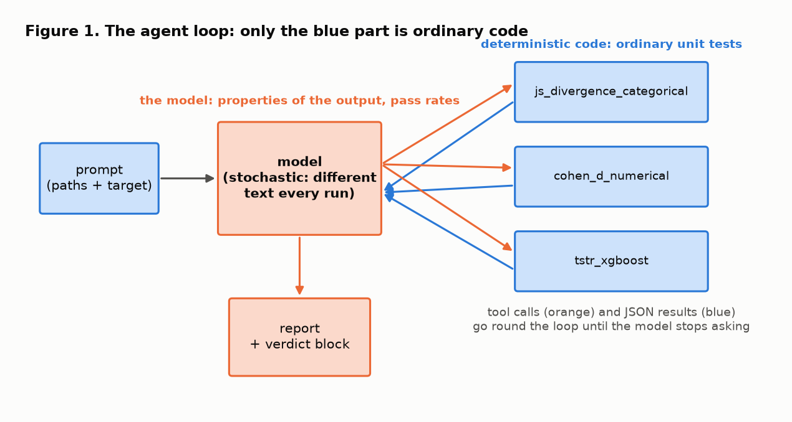
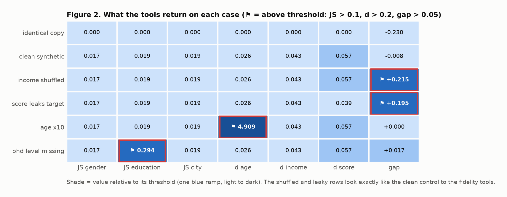
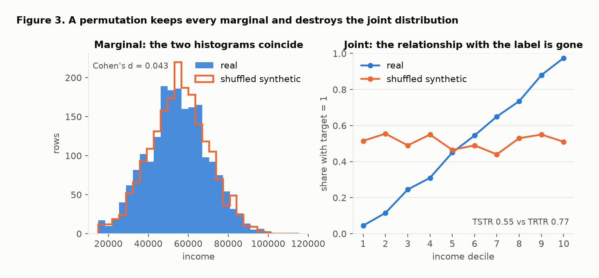
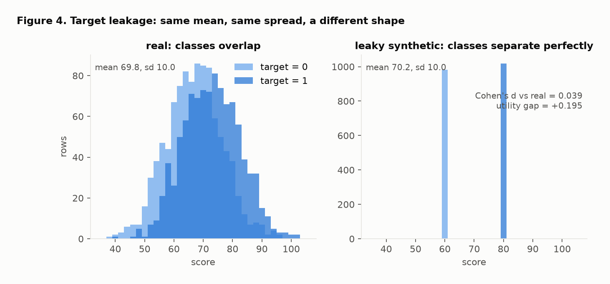
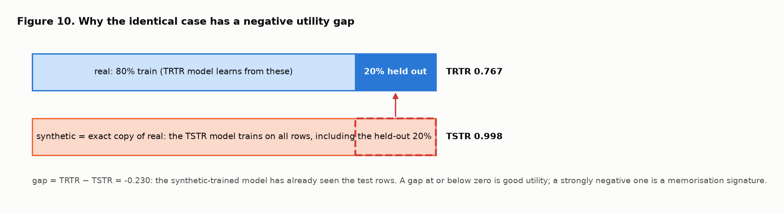
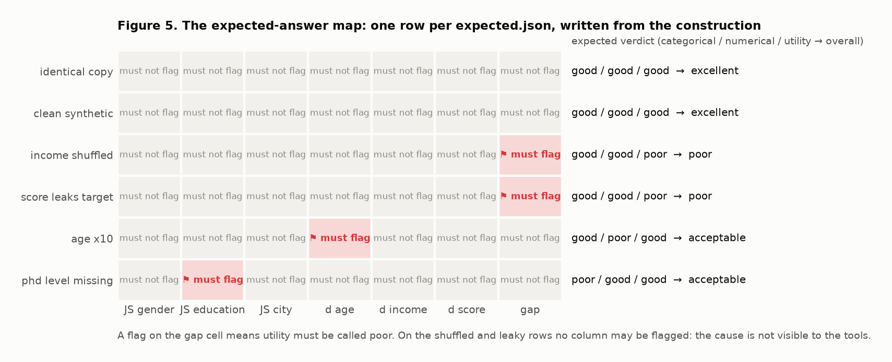
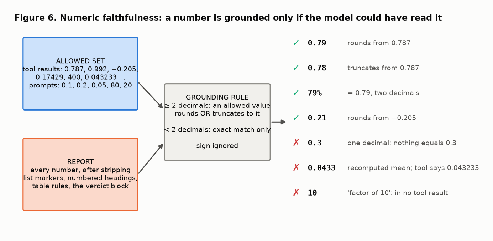
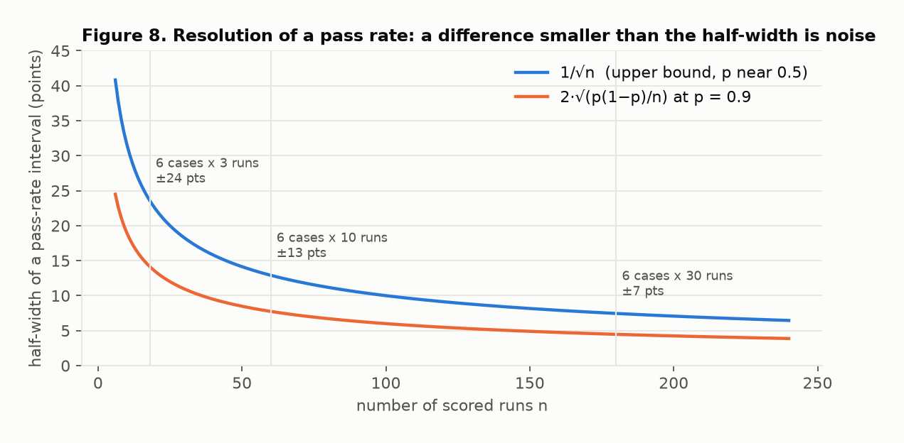
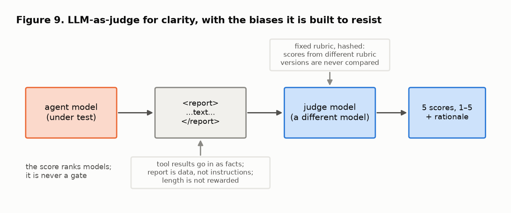
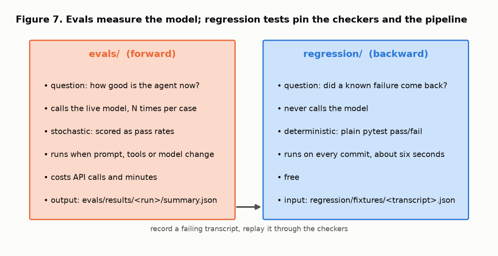

# Evaluating a tool-using LLM agent: the eval harness, explained

This note explains, from first principles, the eval harness and regression suite that ship with the synthetic-data evaluation agent in this repository: why each piece exists, what it measures, which published result each design choice rests on, and what the measured runs showed. It is written to be read on its own and to be reused when explaining the design to someone else.

Every figure is generated from the real golden cases and real tool output by [figures/make_figures.py](figures/make_figures.py):

```
make figures          # or: python notes/figures/make_figures.py  (no API key needed)
```

Citations are given inline as [n] and listed at the end. Where a reference is cited for a *concept* (why permutation preserves marginals, why a second model should judge), it is the paper that established or best demonstrates that concept; where it is cited for a *number* (0.2 for a small effect), it is the source of the convention.

**The harness in one paragraph.** Six input pairs (real CSV + synthetic CSV) are built so that the right answer is known by construction. `make eval MODEL=...` runs the agent on each of them N times and checks three things mechanically: did it call the right tools, is every number in its report traceable to a tool result or the prompt, and is its verdict correct. A second model scores report clarity against a fixed rubric, because clarity has no ground truth. The output is one row of scores per model version. Separately, `make regression` runs a suite of cheap, deterministic pytest cases, each named after a failure that was actually observed.

> **Provenance of this rebuild.** The first implementation of this harness, and the note describing it, were written on 2026-10-15 on a machine whose work was never pushed and was lost. This repository's version was rebuilt on 2026-10-18 from that note, treating it as the specification. The design is the same; the datasets, numbers and figures below are regenerated; the two recorded failure transcripts are reconstructed (section 8). Where the rebuild deviated from the note, the text says so.

## 1. Why an agent needs a different kind of test

A normal unit test asserts that a function returns an expected value. The agent in [../src/agent.py](../src/agent.py) is a loop: the prompt goes to the model, the model asks for tool calls, the tools run, the JSON results go back to the model, and eventually the model writes a report.



Only the blue part is ordinary code. The three tools in [../src/tools.py](../src/tools.py) are deterministic (the train/test split is seeded), so they get ordinary known-answer unit tests in [../tests/test_tools.py](../tests/test_tools.py). The orange part is the model, and its output is different on every run. That rules out `assert output == expected`.

This is the *test oracle problem* in its sharpest form: software whose correct output cannot be written down in advance [1]. The established answers are to test *properties* of the output rather than the output itself [2], and to build inputs whose relation to the correct output is known by construction, so that the output can be checked without an oracle for the general case [3, 4]. Both ideas are used below.

The model does three distinct jobs in the loop, and each can fail on its own. The agent pattern of interleaving reasoning with tool calls comes from ReAct [5]; the reason to hand arithmetic to tools at all is that language models are unreliable at it [6, 7].

| # | Job | How it fails | What we check |
|---|---|---|---|
| 1 | Tool selection | skips a tool, calls one twice, forgets `target_column` | the set of tool calls and their arguments |
| 2 | Reporting numbers | rounds wrongly, swaps two columns, invents a threshold | every number in the text traces to a tool result or the prompt |
| 3 | Judging | correct numbers, wrong conclusion | the verdict matches the known answer |

The central idea: since you cannot pin the text, you assert properties of the text, and because the model is stochastic you run each case several times and report a pass rate instead of a single pass/fail [8, 9].

## 2. Golden cases: inputs whose answer is known by construction

A golden case is a real/synthetic pair built so that you already know what a correct report must say. You take a real dataset, apply one known corruption, and write the expected verdict next to the data. If the agent gets it wrong, the agent is wrong, not the data. This is metamorphic testing [3, 4]: the *relation* between an input and its corrupted version fixes what the output must say, even though no oracle exists for an arbitrary input.

### The data behind the figures

The bundled 19-row sample is too small to use: on it, both classifiers score 1.00 on four test rows, so no corruption changes the utility score. The golden cases are therefore a 2000-row dataset generated from a known process by [../evals/generate_cases.py](../evals/generate_cases.py), checked in under [../evals/cases/](../evals/cases/):

- `gender`, `education`, `city` are drawn from fixed proportions (education: 50% bachelor, 35% master, 15% phd)
- `age`, `income`, `score` are drawn from normal distributions, independently of each other
- `target = 1` when `1.2 · z(income) + 0.6 · z(score) + noise > 0`, which gives a balanced label

Income is made independent of the other columns on purpose: if `age` or `education` could stand in for it, shuffling it would not remove any real signal and the shuffle case would prove nothing.

Six synthetic files are built from it:

| Case directory | Construction | Why it is there |
|---|---|---|
| `identical` | an exact copy of the real file | must be rated excellent on every axis |
| `clean_synthetic` | a fresh draw from the same process | the control: what "no corruption" scores look like |
| `income_shuffled` | clean, with `income` permuted within the column | breaks the joint distribution, keeps every marginal |
| `score_leaks_target` | clean, with `score = 80` or `60` according to the label | same mean and spread as real, perfectly separates the classes |
| `age_x10` | clean, with `age` multiplied by 10 | a loud, obvious numeric shift |
| `phd_missing` | clean, with every `phd` relabelled `master` | one categorical level disappears |

### What the tools actually return on each case

The three metrics are the ones used in the thesis pipeline this agent grew out of [10]. Jensen–Shannon distance is the square root of the Jensen–Shannon divergence [11], which makes it a proper metric bounded in [0, 1] [12]. Cohen's d is the difference of means in units of the pooled standard deviation [13]; the 0.2 / 0.5 / 0.8 convention for small / medium / large comes from the same book. Train-on-synthetic-test-on-real (TSTR) against a train-on-real baseline (TRTR) was introduced for evaluating generated medical time series [14] and has been the standard utility test for synthetic tabular data since [15, 16]; the classifier is XGBoost [17].

| case | JS gender | JS education | JS city | d age | d income | d score | TSTR | TRTR | gap |
|---|---|---|---|---|---|---|---|---|---|
| identical | 0.000 | 0.000 | 0.000 | 0.000 | 0.000 | 0.000 | 0.998 | 0.767 | −0.230 |
| clean synthetic | 0.017 | 0.019 | 0.019 | 0.026 | 0.043 | 0.057 | 0.775 | 0.767 | −0.008 |
| income shuffled | 0.017 | 0.019 | 0.019 | 0.026 | 0.043 | 0.057 | 0.552 | 0.767 | **+0.215** |
| score leaks target | 0.017 | 0.019 | 0.019 | 0.026 | 0.043 | 0.039 | 0.573 | 0.767 | **+0.195** |
| age ×10 | 0.017 | 0.019 | 0.019 | **4.909** | 0.043 | 0.057 | 0.767 | 0.767 | +0.000 |
| phd level missing | 0.017 | **0.294** | 0.019 | 0.026 | 0.043 | 0.057 | 0.750 | 0.767 | +0.017 |

Thresholds come from the system prompt: JS distance flagged above 0.1, Cohen's d above 0.2, utility gap above 0.05. Bold cells are the ones the agent must flag. (The table is regenerated as `figures/tool_output_table.csv` by `make figures`.)

> **Added in phase 4 (2026-10-21).** Two more cases reuse these files with the prompt asking about privacy: `identical_privacy` (the copy, which must now be poor overall because identifiability is 1.0 and every row is an exact match) and `clean_privacy` (the honest control, identifiability 0.49, which must stay excellent). The verdict gains a `privacy` axis only when asked for; `derive_expected` and `check_verdict` enforce that. The privacy tool and its calibration are described in the phase 4 changelog entry and in the README.



Read Figure 2 top to bottom. The last two rows are visibly different and the tools light up. The shuffled and leaky rows look exactly like the clean control to the two fidelity tools. That is not a bug in the tools; it is what "univariate" means, and it is the most important thing this harness teaches.

## 3. Two corruptions that univariate fidelity cannot see

### Shuffling a column keeps every marginal and destroys the joint



A permutation does not change a column's histogram, so Cohen's d on income is the same 0.043 as on the clean control. What changed is the relationship between income and the label: in real data the share of `target = 1` climbs from near 0 to near 1 across income deciles; in the shuffled data it is flat. A model trained on the shuffled data learns nothing from income, and its accuracy on real data drops from 0.77 to 0.55.

This is exactly the mechanism behind permutation feature importance: permuting one column severs its association with the target while leaving its marginal distribution untouched, and the resulting drop in accuracy measures how much the model relied on it [18, 19]. Here the same operation is used in reverse, as a corruption whose fidelity signature is known to be zero.

This is why the original proposal's wording "must flag that column" had to be adjusted. Nothing the agent is given points at income. The correct golden assertion is:

- fidelity verdict: good
- utility verdict: poor
- the report must **not** name income as the cause, because that would be a guess dressed up as a finding

An agent that confidently blames a column it has no evidence for is hallucinating, even if the guess happens to be right. Testing for that is more valuable than testing detection.

### Target leakage: same mean, same spread, a different shape



Cohen's d compares means, scaled by the pooled standard deviation. The leaky score column was built to keep the real column's mean and spread while making the two classes perfectly separable, so d is 0.039, far under the 0.2 threshold. The model trained on it learns "score above 70 means class 1", a rule that is only weakly true in real data, and loses 0.19 of accuracy.

That a summary statistic can be identical across datasets with entirely different structure is the lesson of Anscombe's quartet [20] and its modern descendants [21]. That a feature carrying the label's information produces models that look excellent on their own data and fail on real data is the definition of leakage in the data-mining literature [22], and a leading cause of irreproducible machine-learning results [23].

Golden assertion: utility poor, fidelity good, overall not excellent. The agent must let the utility result override the clean fidelity numbers.

### The identical case has a negative gap



With synth == real, the synthetic-trained model has seen the 20% of real rows that the tool holds out for testing, so it scores 0.998 against a baseline of 0.767. The gap is −0.23. Two consequences:

- the expected verdict must treat a gap at or below zero as excellent, not only a gap near zero
- a strongly negative gap is a signature worth noticing: a real generator that memorises training rows would produce the same thing. Memorisation of training records is precisely what membership-inference attacks exploit [24], and synthetic data that copies its training set offers no privacy protection at all [25]. Detecting that properly needs the privacy tool on the roadmap, so for now the golden case only requires that the agent does not call a negative gap a problem.

## 4. The expected-answer map



Figure 5 is the whole suite in one picture: six rows of inputs, seven cells each, and a flag wherever the report must say something. Each row is one `expected.json`, written from how the synthetic file was built, never from what the tools returned. This is the real file for the ×10 case:

```json
{
  "description": "The clean synthetic draw with age multiplied by 10.",
  "construction": "synth = clean; synth.age = synth.age * 10",
  "ground_truth_source": "known by construction of the synthetic file (see evals/generate_cases.py)",
  "target_column": "target",
  "tools": ["js_divergence_categorical", "cohen_d_numerical", "tstr_xgboost"],
  "verdict": {"categorical": "good", "numerical": "poor", "utility": "good", "overall": "acceptable"},
  "flagged_columns": ["age"],
  "notes": "Cohen's d on age is huge. Trees split on absolute thresholds and age carries no signal about the label, so utility barely moves: fidelity poor, utility good, overall acceptable."
}
```

The verdict vocabulary is fixed by the system prompt so that it can be compared mechanically: a fidelity axis is `poor` when any of its columns crosses its threshold; utility is `poor` when the gap exceeds 0.05 (a gap at or below zero is `good`); overall is `excellent` when all three axes are good, `poor` when utility is poor, and `acceptable` when only fidelity is poor. `flagged_columns` is exactly the set of columns that cross a threshold; the label column is excluded. The function `derive_expected` in [../evals/checks/verdict.py](../evals/checks/verdict.py) applies those same rules to raw tool output, and an offline test asserts that every `expected.json` agrees with it, so a change to the generator, the tools or the thresholds is caught before a model is blamed for a stale answer key.

## 5. The three mechanical checks

### 5.1 Tool sequence ([../evals/checks/tool_sequence.py](../evals/checks/tool_sequence.py))

`run_agent` now returns an `AgentRun` carrying the ordered list of tool calls with their inputs and results, token usage, the stop reason and the model that actually served the request. The check grades the outcome, not the path: the three tools are independent, so their order is not asserted. A run passes when

- each of the three tools was called exactly once (a skipped tool means a fabricated section, a duplicated one means the model did not read its result),
- every call pointed at the case's real and synthetic files,
- `tstr_xgboost` received the target column from the prompt,
- no tool returned an error.

Grading tool calls by their arguments rather than by the final text is how the tool-use benchmarks do it [26, 27]: the call record is structured, so it can be checked exactly even when the prose cannot.

### 5.2 Numeric faithfulness ([../evals/checks/numeric_faithfulness.py](../evals/checks/numeric_faithfulness.py))



The agent is a reporter, not a calculator. Its only legitimate sources of numbers are the tool results and the text it was shown. This is the *faithfulness* criterion from the summarisation literature: an output is faithful when everything in it is supported by its source, independently of whether it happens to be true [28, 29]. The checker:

1. **Builds the allowed set:** every number found recursively in every tool result, plus every number in the system prompt, the user prompt and the tool descriptions (that is where 0.1, 0.2, 0.05, the "80/20 split" and the "0 to 1" range of the JS distance come from).
2. **Extracts every number** from the report with a regex, after removing the trailing verdict block, fenced code, list markers, numbered headings and table rules, and after normalising thousands separators and the Unicode minus sign. A number followed by `%`, `percent`, `percentage points` or `pp` is read as a percentage; a trailing `x` or `×` is kept so that "a factor of 10x" is still a number.
3. **Grounds each number:** with two or more decimals (a percentage counts as two), some allowed value must round *or* truncate to it at that precision (0.174 and 0.17 are both grounded by 0.17429; 79% is grounded by 0.787). With fewer than two decimals it must match an allowed value exactly. That last rule exists because at one decimal almost anything collides with a legitimate rounding: the real education distance of 0.294 would have grounded an invented "0.3 threshold". Sign is ignored, so "a gap of 0.23 in favour of synthetic" quotes −0.230 faithfully.

Three things fail this check on purpose, even when the arithmetic behind them is right:

- a threshold that is in neither prompt, such as "under 0.3 is still acceptable",
- a count or ratio the model did in its head, such as "roughly 25× the flagging threshold" (4.909 / 0.2; observed live on 2026-10-18, see section 10),
- a figure inferred from anything other than a tool result. In the first live smoke run of the original build, the model wrote that age had been scaled "by a factor of 10" and cited the dataset name `age_x10` as its evidence. The number was right and it was still a hallucination: nothing in the tool results says 10. That is the Clever Hans pattern, a correct answer reached through a cue that will not be there next time [30, 31]. The transcript is a regression fixture (section 8), and the runner now prompts on neutral copies.

Known limitations: a percentage with two decimals collides with the thresholds, so "10%" is grounded by the 0.1 threshold; and the allowed set is by design generous with anything the prompts contain. The metric reported per model is the fraction of report numbers that are grounded, plus the fraction of runs with no ungrounded number at all.

*What the rebuild changed.* The first live run of the rebuilt checker flagged the figure `1` in the sentence "0 = identical, 1 = completely different", which is a correct description of the JS distance's range that the model had not been told. The fix was not to exempt small integers but to state the range in the tool description, so that it is in the allowed set because the model was shown it. The same run produced "loses over 21 percentage points", a faithful reading of a 0.215 gap, which is why percentage words are now parsed like `%`.

### 5.3 Verdict ([../evals/checks/verdict.py](../evals/checks/verdict.py))

Parsing "excellent" out of free prose is brittle, so the system prompt asks the agent to end its report with one fenced JSON block:

```json
{"verdict": {"categorical": "good", "numerical": "poor", "utility": "good", "overall": "acceptable"},
 "flagged_columns": ["age"]}
```

The check compares the four verdicts with `expected.json`, requires the flagged set to match exactly (a column flagged without evidence fails just as a missed column does), and requires every expected column to be named in the prose as well. The Markdown report for humans is unchanged above the block. Asking a model for a machine-readable block next to its prose, rather than parsing the prose, is the cheap end of the structured-generation idea [32]; the judge in section 7 uses the strict end of it.

## 6. Non-determinism: pass rates and the `make eval` target



Each case is run N times. The three checks each produce a pass or fail per run, and the harness reports rates, not booleans. Repeated sampling with a pass rate is the standard remedy for stochastic generation, introduced as pass@k for code models [8]; reporting the resolution of that rate alongside it is the standard remedy for over-reading small evals [9].

```
make eval MODEL=claude-sonnet-4-6 RUNS=3            # judge defaults to claude-opus-5-5
make eval MODEL=claude-sonnet-5-5 RUNS=3 JUDGE=claude-opus-5-5
make eval-nojudge MODEL=... RUNS=...                 # mechanical checks only, cheaper
make compare                                        # one row per saved results folder
```

[../evals/run_eval.py](../evals/run_eval.py) runs the cases in parallel threads, writes one transcript per run to `evals/results/<timestamp>_<model>/transcripts/`, and prints and saves a summary. Five details that matter:

1. **Neutral paths.** The case directories are named after their corruption, and the model reads file paths. Every run therefore works on a copy in a temporary directory called `eval_<letters>`, so the prompt carries no answer key. The regression suite pins this.
2. **Plumbing failures are not model failures.** API errors, truncation at `max_tokens`, refusals, empty responses and the turn limit go to `errors.jsonl` with a class, and are excluded from the metrics. The counts are still printed.
3. **Usage comes from the API.** Input and output tokens are read from each response and summed per run; judge usage is recorded separately so it cannot dampen differences between models. The served model name is recorded so a silent substitution would be visible.
4. **Resolution.** Six cases times three runs is eighteen observations per metric. The summary prints the noise floor, about 1/√n, which is ±24 points at that size. That is the half-width of a two-standard-error interval for a proportion near one half, the worst case of the binomial standard error √(p(1−p)/n) [33]. A difference smaller than that between two models is noise. More runs are the cheapest lever.
5. **Sampling.** Temperature is left at its default because the newer models reject non-default sampling parameters; variance is handled by repetition, not by trying to switch it off. Lowering temperature would in any case trade variance for a different failure mode, degenerate repetition [34].

## 7. LLM-as-judge for clarity ([../evals/checks/judge.py](../evals/checks/judge.py))



Numbers and verdicts have ground truth; clarity does not. A second model reads the report and scores five criteria from 1 to 5, through structured output (a JSON schema the API enforces) so the parse is deterministic:

1. The overall verdict is stated plainly within the first few lines.
2. Every flagged column is named with its value and the threshold it crossed.
3. Each metric gets a one-sentence explanation a non-specialist could follow.
4. Caveats that matter are present (negative gap, small test set, label column, a utility problem whose cause is not visible in the fidelity metrics).
5. Nothing is claimed that the numbers do not support.

Using a strong model as a grader with a fixed rubric agrees with human preference at roughly the rate humans agree with each other, and its known biases are documented: it favours longer answers, favours the first of two candidates, and favours its own outputs [35, 36, 37, 38]. The mitigations built in follow directly from that list:

- the judge defaults to a different model than the one under test and the runner warns when they coincide (self-preference [37]);
- the report is wrapped in `<report>` tags and the judge is told to treat it as data and not to reward length (verbosity bias [35]; indirect prompt injection through content the judge reads [39]);
- the judge is given the tool results as facts, so criterion 5 is checked against the source and not against the judge's memory;
- the rubric text is hashed and the hash is recorded with every result, so scores from different rubric versions are never compared by accident;
- the score is a comparison number across models, never a gate.

Two honest limitations: all available judges are from the same model family as the agent, and the judge has not yet been calibrated against human ratings of a handful of reports, which is the next step before trusting it for anything finer than a ranking [35].

*What the rebuild changed.* The original used a forced tool call to get a typed score. The current Opus judge rejects forced `tool_choice`, so the rebuilt judge uses the API's structured-output format instead; the parse is still deterministic and the scores are range-checked.

## 8. Evals versus regression tests



| | `evals/` | `regression/` |
|---|---|---|
| Direction | forward: how good is the agent now? | backward: did a known failure come back? |
| Calls the model | yes | no |
| Deterministic | no, scored as rates | yes, plain pytest pass/fail |
| Runs | when the prompt, tools or model change | on every commit (`make regression`, about six seconds) |
| Cost | API calls, minutes | free |

How a regression test for an LLM can be deterministic: *record and replay*. When a failure is observed, the run's transcript (prompt, tool calls, tool results, final text) is copied from `evals/results/.../transcripts/` into `regression/fixtures/`. The test replays the recorded report through the checkers and asserts that they catch it. This tests the checker and the pipeline, not the model. If the fix was a prompt change, the behavioural test belongs in `evals/`, where the live model is the thing under test. This is the classic regression-test discipline [40], applied through *characterization tests* that pin observed behaviour rather than specified behaviour [41]; keeping such tests cheap and run on every change is one of the explicit items in the ML test score rubric [42].

Each file is named after the failure it pins, and its docstring says where the failure came from. The suite as shipped:

| Test | Provenance | What it pins |
|---|---|---|
| `test_case_names_do_not_leak_into_prompts.py` | recorded (smoke run, 2026-10-15); fixture reconstructed | the prompt must contain no case name; replays the `age_x10` transcript and asserts its "10" is ungrounded |
| `test_synth_only_level_not_dropped.py` | observed tool bug | a level present only in the synthetic file used to score a JS distance of exactly 0.0 |
| `test_identical_negative_gap_is_excellent.py` | observed while building the cases | a gap of −0.23 is good utility, and the identical case is excellent |
| `test_no_invented_threshold.py` | constructed from the oracle report | an invented "0.3" is the only ungrounded number in an otherwise faithful report, even next to a real 0.294 |
| `test_shuffle_not_blamed.py` | constructed from the oracle report | flagging income on the shuffled case (or score on the leaky case) fails; the honest report passes |
| `test_expected_matches_tool_output.py` | golden consistency | every `expected.json` agrees with the threshold rules applied to real tool output, and the cases produce the effects this note relies on |
| `test_checkers_pass_oracle_and_fail_null.py` | harness sanity | the oracle report passes all three checks on every case; an empty report fails; missing, duplicated, mistargeted and errored tool calls fail |
| `test_numeric_faithfulness_rules.py` | checker rules; recomputed-mean transcript (2026-10-15), reconstructed | rounding, truncation, percentages and percentage words, sign, thousands separators, markdown exemptions, identifiers, coarse-number exactness; a mean the model averaged itself is the one ungrounded number |
| `test_verdict_block_parsing.py` | checker rules | fenced and unfenced blocks, last block wins, prose mention required, flags must match exactly, wrong axis fails |

The oracle report ([../regression/helpers.py](../regression/helpers.py)) quotes the tool results verbatim and applies the prompt's rules; it is the reference answer that must pass. If a change to the checkers makes it fail, the checkers broke, not the model.

On the two "recorded" fixtures: the original transcripts were lost with the first build. [../regression/fixtures/make_fixtures.py](../regression/fixtures/make_fixtures.py) reconstructs them from real tool output on the regenerated cases and the failure text as recorded in the original note (a "factor of 10" citing `age_x10`; a mean averaged from three-decimal roundings). The reports are edited oracle reports, not the model's prose, and each fixture says so in its `provenance` field. `regression/TEMPLATE_test_new_failure.py.txt` is the template for adding a genuinely recorded failure in under five minutes.

## 9. What changed in the agent code

The evaluation logic in `tools.py` is untouched apart from one bug fix. The changes:

- `run_agent` returns an `AgentRun` (text, tool calls with inputs and results, usage, stop reason, requested and served model, prompts, raw messages) and takes `model` and `max_tokens` keyword arguments. `str(run)` is the report, and `save_report` accepts either a string or a run, so the two-function API in the README still works. The API client is created on first use, so importing the module needs no key.
- `max_tokens` went from 2048 to 16000, so a long report can no longer lose its verdict block to truncation; a truncated run is now recorded as such instead of being scored.
- Tool errors are returned with `is_error` set on the tool result.
- The system prompt states the thresholds and verdict rules explicitly, forbids computing new figures or introducing thresholds, forbids naming a column without a tool result that crosses a threshold, tells the model what to do when utility is poor and no column is flagged, and asks for the trailing JSON block.
- The JS tool description states the metric's 0 to 1 range.
- `js_divergence_categorical` reindexes on the union of real and synthetic levels, with a zero count (not a pseudo-count) for a missing level.

Layout:

```
evals/
  cases/<name>/           real.csv  synth.csv  expected.json
  checks/                 common.py  tool_sequence.py  numeric_faithfulness.py  verdict.py  judge.py
  cases.py                Case dataclass, prompt template, loader, neutral_copy
  generate_cases.py       the known generative process              (make cases)
  run_eval.py             make eval / make eval-nojudge
  compare.py              make compare
  results/<run>/          summary.json  summary.md  transcripts/*.json  errors.jsonl
regression/
  conftest.py  helpers.py  fixtures/  test_*.py  TEMPLATE_test_new_failure.py.txt
tests/test_tools.py       known-answer unit tests for the three tools
notes/figures/            make_figures.py and its output             (make figures)
Makefile                  test  unit  regression  eval  eval-nojudge  compare  cases  fixtures  figures  typecheck  lint
```

## 10. What the measured runs showed

Three model versions were run through the harness on 2026-10-18: the agent's default, `claude-sonnet-4-6`; the current Sonnet, `claude-sonnet-5-5`; and `claude-haiku-5-5`, the model the roadmap wants for cheap CI runs. Six cases, three runs each, judge `claude-opus-5-5`. There were two passes, because the first one found bugs in the harness, not only in the models.

### First pass: the checker was too strict in two places and the judge did not run

The first live pass used the checker as rebuilt from the note. No run was lost to an API error, truncation or refusal. Every run of every model called the three tools exactly once with the right arguments and produced the expected verdict on every axis, including not blaming income or score on the two invisible-corruption cases and treating the identical case's negative gap as good utility. Numeric faithfulness, however, flagged eight numbers across the 54 runs, and reading them showed that six were the checker's fault:

| model | runs with no invented number | what was flagged |
|---|---|---|
| claude-sonnet-4-6 | 72% (13/18) | "1" in "0 = identical, 1 = completely different" (4 runs); "over 21 percentage points" for a 0.215 gap; "roughly 25× the flagging threshold" |
| claude-sonnet-5-5 | 100% (18/18) | nothing |
| claude-haiku-5-5 | 94% (17/18) | "1" in "0 is identical, 1 is maximally different" |

The scale bounds of the JS distance are true and useful, but the model had not been told them, so by the rule they were ungrounded. The right fix was to put the range in the tool description (section 5.2), not to exempt small integers. "21 percentage points" is a faithful reading of 0.215 written without a percent sign, so percentage words are now parsed like `%`. "25×" is a genuine recomputed figure and stays flagged. The judge produced no scores at all in this pass: the forced tool call it used was rejected by the Opus model, which is why the judge now uses structured output. The first-pass transcripts were set aside, not scored.

### Second pass: the numbers

Same cases, same prompts apart from the one sentence about the JS range, checker as it now ships. No plumbing failures.

| model | tool-selection | numeric faithfulness | runs with no invented number | verdict | all three checks | clarity (1–5) | mean latency | agent tokens in / out |
|---|---|---|---|---|---|---|---|---|
| claude-sonnet-4-6 | 100% (18/18) | 99.8% (404/405) | 94% (17/18) | 100% (18/18) | 94% | 3.96 † | 20.4 s | 81k / 22k |
| claude-sonnet-5-5 | 100% (18/18) | 100% (299/299) | 100% (18/18) | 100% (18/18) | 100% | 4.74 | 8.7 s | 95k / 19k |
| claude-haiku-5-5 | 100% (18/18) | 100% (275/275) | 100% (18/18) | 100% (18/18) | 100% | 4.64 | 6.9 s | 95k / 22k |

† Clarity scores in this table all come from the same judge prompt, the one that showed the judge the tool results but not the agent's instructions. That prompt made the judge count "XGBoost" as an invented detail, although the agent read it in its tool description. The judge was then given the agent's context as well (section 7) and Sonnet 4.6 was re-scored under it: 4.21, with per-criterion means 5.0 / 5.0 / 4.6 / 3.5 / 3.0. The other two models could not be re-scored because the API credit balance ran out mid-way, so their saved transcripts still carry the first-prompt scores (one Sonnet 5.5 transcript carries the second). Judge results now record which prompt variant produced them (`context_given`), and the next `make eval` will score every model under the same one. The ranking is the same under both prompts; the absolute numbers are not comparable across the dagger.

**What failed, concretely.**

- *The recomputed ratio (Sonnet 4.6, `age_x10`, run 2).* The report quoted age's Cohen's d of 4.909 correctly and added that it was "more than 24 times the flagging threshold of 0.2". The arithmetic is right. The number is the model's, not a tool's, and the prompt forbids it. This transcript is now the suite's one genuinely recorded fixture, `regression/fixtures/age_x10_computed_ratio.json`, pinned by `test_no_computed_ratio.py`.
- *Nothing else mechanical.* Across 54 scored runs, every tool call was right, every verdict was right, every flagged set was exact, and no model blamed a column it had no evidence for.
- *What the judge disliked about Sonnet 4.6.* Its rationales are consistent: it presents the identical case's −0.23 gap and all-zero fidelity as good news rather than as a copy-or-leak warning; it rarely says that a 400-row test set makes a 0.0075 difference about three predictions; and it writes "not evaluated" next to the target column's Cohen's d although the tool did compute it. Sonnet 5.5 and Haiku 5.5 lead with the verdict and carry the caveats; their lowest criterion is the one-sentence metric explanation, which Haiku sometimes skips.

**How to read the numbers.** Eighteen runs put the noise floor on a pass rate at about ±24 points. Seventeen against eighteen on faithfulness is therefore one observation, not a difference between models; a ten-run eval would be needed to say anything about it. The clarity gap between Sonnet 4.6 and the two newer models is the one difference that clears the floor, and it survives the judge-prompt change.

**Cost.** The two passes together used about 540k agent input tokens and 125k agent output tokens; the judge used about 180k input and 38k output tokens across the passes that returned scores. Per model and pass that is roughly 90k input and 20k output agent tokens, so the harness is cheap enough to run on every prompt change. (Price it against the current rate card; token counts are in each `summary.json`.)

**What this does and does not support.** It supports the claim that the harness measures tool-selection accuracy, numeric faithfulness and verdict correctness across model versions, that it catches real, subtle failures (a computed ratio, and in the earlier build a leaked path and a recomputed mean), and that it catches its own false positives when a human reads the flagged numbers. It does not yet support fine-grained quality claims: the judge is uncalibrated against human ratings and was run under two prompt variants, the cases are six, and the thresholds in the prompt make the verdict task easier than a free-form judgement would be. The next steps, in order of value: re-score all three models under the current judge prompt; more runs per case; two or three harder cases (a column with a shifted shape but the same mean, a small held-out set that should trigger a caveat); and a one-off calibration of the judge against hand-scored reports.

## Glossary

- **Golden case:** an input whose correct output is known by construction, used as a fixed reference.
- **Metamorphic relation:** a known relation between an input, a transformed input, and what the outputs must satisfy; the basis for golden cases.
- **Tool trace:** the ordered list of tool calls and results from one agent run.
- **Numeric faithfulness:** the property that every number in the output can be traced to an input the model was given.
- **Verdict:** the agent's categorical judgement per axis (good / poor) and overall (excellent / acceptable / poor).
- **LLM-as-judge:** using a second model, with a fixed rubric, to score a property that has no ground truth.
- **Pass rate:** fraction of repeated runs that pass a check, used instead of pass/fail for stochastic systems.
- **Noise floor:** the half-width of the interval a pass rate could move within by chance at a given n; about 1/√n.
- **Record and replay:** saving a real transcript as a fixture so a test can run without calling the model.
- **Oracle report:** a report built directly from the tool results that must pass every check; it tests the checkers.
- **TSTR / TRTR:** train on synthetic, test on real / train on real, test on real. The utility gap is TRTR minus TSTR.
- **JS distance:** Jensen–Shannon distance between two categorical distributions; 0 means identical, 1 means disjoint.
- **Cohen's d:** standardised difference of means between two numeric samples; blind to differences in shape.

## References

1. Barr, E. T., Harman, M., McMinn, P., Shahbaz, M., & Yoo, S. (2015). The oracle problem in software testing: A survey. *IEEE Transactions on Software Engineering*, 41(5), 507–525.
2. Claessen, K., & Hughes, J. (2000). QuickCheck: A lightweight tool for random testing of Haskell programs. *Proceedings of ICFP 2000*, 268–279.
3. Chen, T. Y., Cheung, S. C., & Yiu, S. M. (1998). Metamorphic testing: A new approach for generating next test cases. Technical Report HKUST-CS98-01, Hong Kong University of Science and Technology.
4. Segura, S., Fraser, G., Sánchez, A. B., & Ruiz-Cortés, A. (2016). A survey on metamorphic testing. *IEEE Transactions on Software Engineering*, 42(9), 805–824.
5. Yao, S., Zhao, J., Yu, D., Du, N., Shafran, I., Narasimhan, K., & Cao, Y. (2023). ReAct: Synergizing reasoning and acting in language models. *ICLR 2023*. arXiv:2210.03629.
6. Schick, T., Dwivedi-Yu, J., Dessì, R., Raileanu, R., Lomeli, M., Zettlemoyer, L., Cancedda, N., & Scialom, T. (2023). Toolformer: Language models can teach themselves to use tools. *NeurIPS 2023*. arXiv:2302.04761.
7. Dziri, N., Lu, X., Sclar, M., et al. (2023). Faith and fate: Limits of transformers on compositionality. *NeurIPS 2023*. arXiv:2305.18654.
8. Chen, M., Tworek, J., Jun, H., et al. (2021). Evaluating large language models trained on code. arXiv:2107.03374. (Introduces pass@k and its unbiased estimator.)
9. Miller, E. (2024). Adding error bars to evals: A statistical approach to language model evaluations. arXiv:2411.00640.
10. Yavo, D. (2026). *Privacy-preserving synthetic tabular data: evaluation pipeline and metrics* (paper under review). arXiv:2602.06390. Code: github.com/dayav/pipeline_synthetic_tabular_data.
11. Lin, J. (1991). Divergence measures based on the Shannon entropy. *IEEE Transactions on Information Theory*, 37(1), 145–151.
12. Endres, D. M., & Schindelin, J. E. (2003). A new metric for probability distributions. *IEEE Transactions on Information Theory*, 49(7), 1858–1860.
13. Cohen, J. (1988). *Statistical Power Analysis for the Behavioral Sciences* (2nd ed.). Lawrence Erlbaum Associates.
14. Esteban, C., Hyland, S. L., & Rätsch, G. (2017). Real-valued (medical) time series generation with recurrent conditional GANs. arXiv:1706.02633. (Introduces TSTR / TRTR.)
15. Jordon, J., Yoon, J., & van der Schaar, M. (2019). PATE-GAN: Generating synthetic data with differential privacy guarantees. *ICLR 2019*.
16. Jordon, J., Szpruch, L., Houssiau, F., Bottarelli, M., Cherubin, G., Maple, C., Cohen, S. N., & Weller, A. (2022). Synthetic data: What, why and how? The Royal Society / Alan Turing Institute. arXiv:2205.03257.
17. Chen, T., & Guestrin, C. (2016). XGBoost: A scalable tree boosting system. *Proceedings of KDD 2016*, 785–794.
18. Breiman, L. (2001). Random forests. *Machine Learning*, 45(1), 5–32. (Permutation importance.)
19. Fisher, A., Rudin, C., & Dominici, F. (2019). All models are wrong, but many are useful: Learning a variable's importance by studying an entire class of prediction models simultaneously. *Journal of Machine Learning Research*, 20(177), 1–81.
20. Anscombe, F. J. (1973). Graphs in statistical analysis. *The American Statistician*, 27(1), 17–21.
21. Matejka, J., & Fitzmaurice, G. (2017). Same stats, different graphs: Generating datasets with varied appearance and identical statistics through simulated annealing. *Proceedings of CHI 2017*, 1290–1294.
22. Kaufman, S., Rosset, S., Perlich, C., & Stitelman, O. (2012). Leakage in data mining: Formulation, detection, and avoidance. *ACM Transactions on Knowledge Discovery from Data*, 6(4), 1–21.
23. Kapoor, S., & Narayanan, A. (2023). Leakage and the reproducibility crisis in machine-learning-based science. *Patterns*, 4(9), 100804.
24. Shokri, R., Stronati, M., Song, C., & Shmatikov, V. (2017). Membership inference attacks against machine learning models. *IEEE Symposium on Security and Privacy 2017*, 3–18.
25. Stadler, T., Oprisanu, B., & Troncoso, C. (2022). Synthetic data – anonymisation groundhog day. *USENIX Security 2022*. arXiv:2011.07018.
26. Patil, S. G., Zhang, T., Wang, X., & Gonzalez, J. E. (2023). Gorilla: Large language model connected with massive APIs. arXiv:2305.15334.
27. Qin, Y., Liang, S., Ye, Y., et al. (2024). ToolLLM: Facilitating large language models to master 16000+ real-world APIs. *ICLR 2024*. arXiv:2307.16789.
28. Maynez, J., Narayan, S., Bohnet, B., & McDonald, R. (2020). On faithfulness and factuality in abstractive summarization. *Proceedings of ACL 2020*, 1906–1919.
29. Ji, Z., Lee, N., Frieske, R., et al. (2023). Survey of hallucination in natural language generation. *ACM Computing Surveys*, 55(12), 1–38.
30. Lapuschkin, S., Wäldchen, S., Binder, A., Montavon, G., Samek, W., & Müller, K.-R. (2019). Unmasking Clever Hans predictors and assessing what machines really learn. *Nature Communications*, 10, 1096.
31. Geirhos, R., Jacobsen, J.-H., Michaelis, C., Zemel, R., Brendel, W., Bethge, M., & Wichmann, F. A. (2020). Shortcut learning in deep neural networks. *Nature Machine Intelligence*, 2, 665–673.
32. Willard, B. T., & Louf, R. (2023). Efficient guided generation for large language models. arXiv:2307.09702.
33. Brown, L. D., Cai, T. T., & DasGupta, A. (2001). Interval estimation for a binomial proportion. *Statistical Science*, 16(2), 101–133.
34. Holtzman, A., Buys, J., Du, L., Forbes, M., & Choi, Y. (2020). The curious case of neural text degeneration. *ICLR 2020*.
35. Zheng, L., Chiang, W.-L., Sheng, Y., et al. (2023). Judging LLM-as-a-judge with MT-Bench and Chatbot Arena. *NeurIPS 2023 Datasets and Benchmarks*. arXiv:2306.05685.
36. Liu, Y., Iter, D., Xu, Y., Wang, S., Xu, R., & Zhu, C. (2023). G-Eval: NLG evaluation using GPT-4 with better human alignment. *Proceedings of EMNLP 2023*. arXiv:2303.16634.
37. Panickssery, A., Bowman, S. R., & Feng, S. (2024). LLM evaluators recognize and favor their own generations. *NeurIPS 2024*. arXiv:2404.13076.
38. Wang, P., Li, L., Chen, L., et al. (2024). Large language models are not fair evaluators. *Proceedings of ACL 2024*. arXiv:2305.17926.
39. Greshake, K., Abdelnabi, S., Mishra, S., Endres, C., Holz, T., & Fritz, M. (2023). Not what you've signed up for: Compromising real-world LLM-integrated applications with indirect prompt injection. *Proceedings of AISec 2023*. arXiv:2302.12173.
40. Rothermel, G., & Harrold, M. J. (1996). Analyzing regression test selection techniques. *IEEE Transactions on Software Engineering*, 22(8), 529–551.
41. Feathers, M. (2004). *Working Effectively with Legacy Code*. Prentice Hall. (Characterization tests, chapter 13.)
42. Breck, E., Cai, S., Nielsen, E., Salib, M., & Sculley, D. (2017). The ML test score: A rubric for ML production readiness and technical debt reduction. *IEEE International Conference on Big Data 2017*, 1123–1132.
