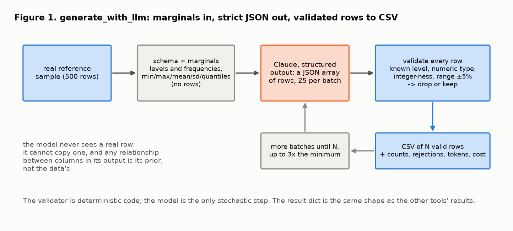
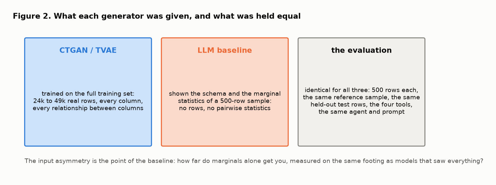
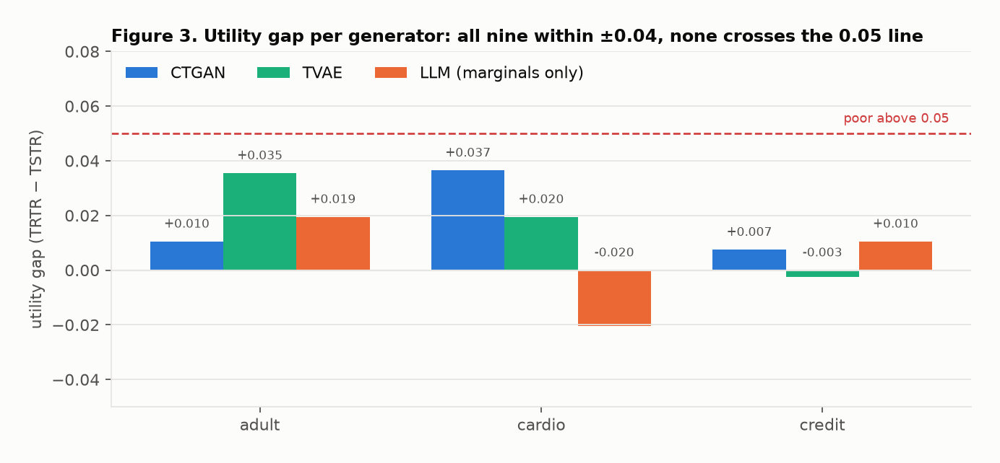
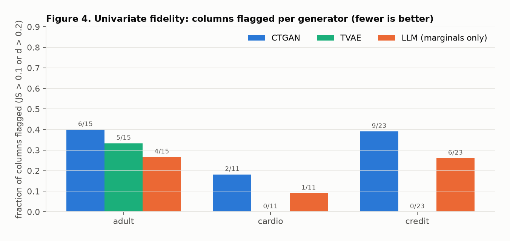
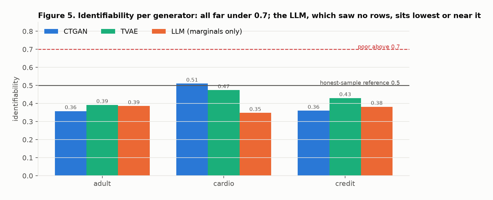

# An LLM as a tabular generator: the baseline, explained

This note explains, from first principles, the last phase of the v2 plan: a tool that asks Claude to generate synthetic tabular rows from a dataset's schema and marginal statistics, and a comparison of that baseline with the thesis pipeline's CTGAN and TVAE outputs on the same metrics, judged by the same agent. It covers why the comparison is set up the way it is, what was held equal and what was not, what the numbers showed, and which published work each choice rests on. The companions are [eval_harness.md](eval_harness.md), [run_logging.md](run_logging.md), [service_and_deployment.md](service_and_deployment.md) and [privacy_tool.md](privacy_tool.md); the code walkthrough for this phase is [llm_generation_baseline_code_walkthrough.md](llm_generation_baseline_code_walkthrough.md).

The data figures are drawn from the measured comparison in `results/generators/comparison.json` by [figures/make_generation_figures.py](figures/make_generation_figures.py) (`make figures`, no API key). Citations are given inline as [n] and listed at the end.

**The design in one paragraph.** `generate_with_llm` reads a real file only to summarise it: for each column its kind, its category levels with frequencies, or its range, mean, standard deviation and quantiles. That summary, and nothing else, goes to the model, which returns rows as a JSON array under a strict schema; every row is validated against the summary and invalid ones are dropped. The comparison script draws one 500-row reference sample and one 2,000-row held-out sample per dataset, cuts the CTGAN and TVAE outputs to 500 rows, generates 500 rows with the LLM from the reference sample's summary, and scores all three with the four tools against the same files, then asks the evaluation agent for its verdict on each. On the three thesis datasets the marginals-only baseline landed in the same band as the deep generators on fidelity and utility, with zero exact matches by construction. The README says, in the same breath, that this is a baseline on three small public datasets and not a claim about LLMs and tabular data.

## 1. Why a generation baseline belongs in an evaluation project

The agent exists to grade synthetic data. Until this phase every dataset it graded came from somewhere else: the golden cases built by corruption, and the pipeline's generators. A generator inside the repository does two things for the evaluator.

- **It closes the loop.** The same four tools and the same agent that score CTGAN and TVAE score the LLM output, so the comparison table is produced by the thing the project is about, not by a separate script with its own definitions.
- **It gives an interview-ready finding about a live question.** Whether language models can generate useful tabular data is an active research topic [1, 2, 3], and the answer is contested. A small, honest measurement on known datasets, with the evaluation held fixed, is worth more than an opinion.

The constraint from the plan was explicit: one tool, one script, one table, and no generalisation. That is what was built.

## 2. The generator: marginals in, strict JSON out

Three choices define the tool.

**The model sees marginals, never rows.** The schema summary carries, per column, the levels and their frequencies for categoricals, and the min, max, mean, standard deviation and five quantiles for numerics. Low-cardinality integers (the cardio dataset's 0/1 and 1/2/3 codes, the targets) are treated as categoricals with integer levels, so the model is told the admissible values rather than a range. No row, no pairwise statistic, no correlation goes in. Two consequences follow and both are deliberate. The model cannot copy a real record, so exact matches are zero by construction and the privacy numbers measure something else (section 5). And any relationship between columns in the output comes from the model's prior about what such columns usually look like, not from the data; the utility result is therefore a measurement of how good that prior is. This is the same question the GReaT and related lines of work ask, where a language model is fine-tuned or prompted on serialised rows [1, 2]; here it is asked in the leanest form, with no rows at all.

**The output is constrained, then validated anyway.** The request uses the API's structured output with a JSON schema: one object per row, every column required, enumerated levels for categoricals, no extra properties. Constrained decoding makes the parse deterministic [4]. It does not make the values right: an integer can be outside the range, a float can be an integer column's value, and the array can be the wrong length (the API accepts no size constraint beyond zero or one item, which the code found out the hard way). So every row is validated client-side against the summary: known level, numeric type, integer-ness, range with 5% slack, and rejected rows are counted by reason. Over 1,500 generated rows exactly one was rejected, a credit payment amount outside the range. Validation is cheap, and the count is what makes the tool's output trustworthy.

**Batches, with a budget.** Rows come 25 at a time, at low effort, until the requested count is reached or three times the minimum number of batches has been spent. The result dict has the same shape as the other tools' results: counts, rejection reasons, tokens, estimated cost from the dated price list, latency, and the schema the model was shown.

One choice that is a boundary, not a feature: the tool is not registered in the evaluation agent's tool list. The agent that grades synthetic data must not be able to generate what it grades. The generator is called by the comparison script and by tests, as a peer of the pipeline's generators, never from inside an evaluation run.

## 3. What was held equal, and what was not

A comparison is only as honest as its footing. The script fixes four things for every generator on a dataset:

1. **The reference sample.** One seeded draw of 500 rows from the training set is the "real" file for every tool call. CTGAN and TVAE outputs are cut to 500 rows by a seeded sample; the LLM generates 500 rows. So every fidelity metric compares 500 against 500, and the identifiability reference level is the same.
2. **The held-out test set.** The utility tool normally splits the real file 80/20. Here it is given an explicit test file, a seeded 2,000-row sample of the dataset's test split, the same for all three generators. TRTR is therefore the same number across the three rows of a dataset in the table, which is what makes the gaps comparable [5].
3. **The metrics and thresholds.** The four tools, with the documented thresholds from phase 5.
4. **The judge.** The same agent, the same prompt (with privacy asked for), the same model.

What was *not* equal, and is stated in the table: CTGAN and TVAE were trained on the full training sets, 24 to 49 thousand rows with every column and every relationship [6]; the LLM saw the schema and marginal statistics of a 500-row sample. The baseline is therefore handicapped on purpose. If it had been shown rows the result would have been a different experiment, and a less interesting one.

## 4. What the comparison showed

Measured on 2026-10-21 with `claude-sonnet-5-5` as the generator and as the judge, 500 rows per generator, one draw each. The full table is in the README and in `results/generators/comparison.md`.

**Utility.** All nine utility gaps lie within ±0.04 and none crosses the 0.05 line. On adult the gaps are 0.010, 0.035 and 0.019 for CTGAN, TVAE and the LLM; on cardio 0.037, 0.020 and −0.020; on credit 0.007, −0.003 and 0.010. A classifier trained on 500 LLM rows with no access to the real joint distribution predicts the real test set about as well as one trained on 500 CTGAN or TVAE rows. The two negative gaps (cardio LLM, credit TVAE) are within the noise of accuracy on 2,000 test rows and are not evidence of anything.

**Univariate fidelity.** The picture differs by dataset. On adult, whose fidelity is mostly categorical, the LLM flagged the fewest columns (4 of the 9 categorical columns, against 6 for CTGAN and 5 for TVAE; no numeric column was flagged for any generator, so Figure 4's fractions are out of all 15) and had the lowest Cohen's d everywhere, which is what you would expect from a generator that was handed the frequency tables and ranges directly. On the two numeric-heavy datasets TVAE flagged nothing, CTGAN flagged 2 and 9 columns, and the LLM sat between them with 1 and 6. The LLM's flagged columns on credit are the repayment-status codes and one payment amount: columns with heavy tails and spikes that a mean, a standard deviation and five quantiles describe poorly. That is a limit of the summary, not of the model, and a seventh quantile or a histogram would be the first thing to try.

**Privacy.** Every generator is far under the 0.7 threshold and no output has an exact match. The LLM's identifiability (0.39, 0.35, 0.38) is at or below the deep generators' and below the 0.5 reference of an honest same-size sample, which is the signature of a generator that places points where the marginals say but without the real joint structure that would put them *near* real records. This is the expected result for a model that never saw a row, and it is also a reminder that a low identifiability is not by itself a quality signal.

**The agent agreed with the tools.** On all nine outputs the agent's verdict followed from the mechanical flags, and the columns it named were exactly the flagged ones. Six acceptable and three excellent: the three excellent being TVAE on cardio and credit, and nothing else.

## 5. How to read this, and how not to

What the result supports: on three public datasets, with the evaluation held fixed, a marginals-only LLM baseline is in the same band as CTGAN and TVAE on utility and on univariate fidelity, flags fewer columns than CTGAN on every dataset, and cannot leak records it never saw. What it does not support: any statement about LLMs and tabular data in general. One draw per cell, 500 rows, three datasets, no error bars; the eval note's resolution argument applies here with force.

Two caveats are specific to this experiment and matter more than the usual ones.

- **These datasets are famous.** Adult [7] and the credit-card default data [8] are in every tutorial, and cardio is a widely used Kaggle set [9]. Language models have been shown to have memorised well-known tabular datasets to the point of reproducing rows [10]. The design keeps the model from being *shown* rows, but cannot keep it from *remembering* them. The measured zero exact matches and identifiability under 0.5 say that it did not reproduce the reference sample's records, which is the relevant check, and the caveat is stated rather than assumed away. A dataset the model cannot have seen would be the cleaner experiment.
- **Utility is measured with one classifier.** XGBoost, as in the thesis pipeline. Tree ensembles are a fair default for tabular data [11], but a generator whose output suits trees may not suit a linear model, and the reverse.

## 6. Cost and practicality

Generating 500 rows cost about 0.90, 0.52 and 1.62 US dollars at list prices for adult, cardio and credit, in 4 to 12 minutes each at 25 rows per batch, sequentially. The credit dataset's 24 columns of wide-range integers are what makes it the expensive one. For comparison, CTGAN and TVAE cost GPU time to train and nothing per row afterwards. At a few thousand rows the LLM baseline is cheap enough to be a routine comparison; at a few hundred thousand it is not, and that is the honest shape of the trade-off, consistent with the broader observation that the strength of LLM generation is the low-data regime [3].

## 7. Limitations and next steps

- **One draw per cell.** Repeating each generation three times would give the noise floor the table lacks.
- **The marginal summary is thin.** Quantiles describe heavy-tailed and spiky integer columns badly; a small histogram per numeric column is the obvious improvement.
- **No pairwise information at all.** Adding a correlation matrix or a handful of conditional frequencies would turn the baseline into a different, stronger generator; that would be a deliberate second experiment, not a fix.
- **Famous datasets.** Section 5.
- **Single classifier, single row count.** A second classifier and a 2,000-row comparison would both be cheap on the deep generators and informative.

## Glossary

- **Marginal statistics:** per-column summaries (frequencies, range, mean, quantiles) that say nothing about how columns relate.
- **Structured output:** asking the API to return JSON that conforms to a schema, so the parse cannot fail.
- **Validation:** checking each returned row against the summary; the schema cannot express ranges or integer-ness.
- **Reference sample:** the fixed 500 real rows every tool compares against for a dataset.
- **Held-out test set:** real rows neither generator nor classifier saw, on which TSTR and TRTR are both scored.
- **TSTR / TRTR:** train on synthetic, test on real; train on real, test on real. The gap is TRTR minus TSTR.
- **CTGAN / TVAE:** conditional GAN and variational autoencoder for mixed-type tables, the pipeline's generators.
- **Footing:** the set of things held equal across generators: rows, reference, test set, metrics, judge.

## References

1. Borisov, V., Seßler, K., Leemann, T., Pawelczyk, M., & Kasneci, G. (2023). Language models are realistic tabular data generators. *ICLR 2023*. arXiv:2210.06280. (GReaT.)
2. Hegselmann, S., Buendia, A., Lang, H., Agrawal, M., Jiang, X., & Sontag, D. (2023). TabLLM: Few-shot classification of tabular data with large language models. *AISTATS 2023*, PMLR 206, 5549–5581.
3. Seedat, N., Huynh, N., van Breugel, B., & van der Schaar, M. (2024). Curated LLM: Synergy of LLMs and data curation for tabular augmentation in low-data regimes. *ICML 2024*. arXiv:2312.12112.
4. Willard, B. T., & Louf, R. (2023). Efficient guided generation for large language models. arXiv:2307.09702.
5. Esteban, C., Hyland, S. L., & Rätsch, G. (2017). Real-valued (medical) time series generation with recurrent conditional GANs. arXiv:1706.02633. (TSTR / TRTR.)
6. Xu, L., Skoularidou, M., Cuesta-Infante, A., & Veeramachaneni, K. (2019). Modeling tabular data using conditional GAN. *NeurIPS 2019*. (CTGAN and TVAE.)
7. Kohavi, R. (1996). Scaling up the accuracy of naive-Bayes classifiers: A decision-tree hybrid. *Proceedings of KDD 1996*, 202–207. (The Adult census income dataset, UCI repository.)
8. Yeh, I.-C., & Lien, C.-h. (2009). The comparisons of data mining techniques for the predictive accuracy of probability of default of credit card clients. *Expert Systems with Applications*, 36(2), 2473–2480. (The credit-card default dataset, UCI repository.)
9. Ulianova, S. (2019). Cardiovascular Disease dataset. Kaggle. https://www.kaggle.com/datasets/sulianova/cardiovascular-disease-dataset
10. Bordt, S., Nori, H., Rodrigues, V., Nushi, B., & Caruana, R. (2024). Elephants never forget: Memorization and learning of tabular data in large language models. *COLM 2024*. arXiv:2404.06209.
11. Grinsztajn, L., Oyallon, E., & Varoquaux, G. (2022). Why do tree-based models still outperform deep learning on typical tabular data? *NeurIPS 2022 Datasets and Benchmarks*. arXiv:2207.08815.
12. Yavo, D. (2026). *Generating high-quality privacy-preserving synthetic data* (paper under review). arXiv:2602.06390. Outputs: huggingface.co/datasets/dayav/pipeline_tabular_data_results.
