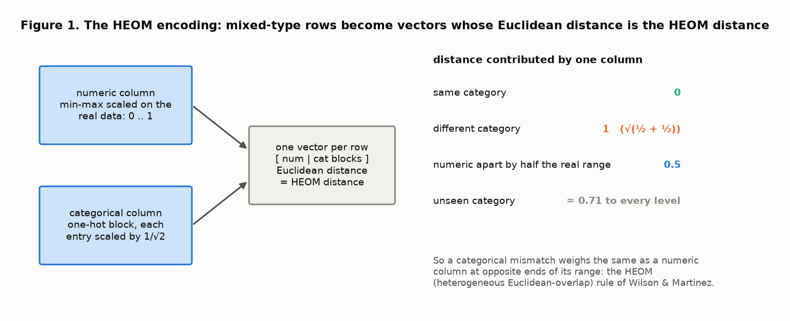
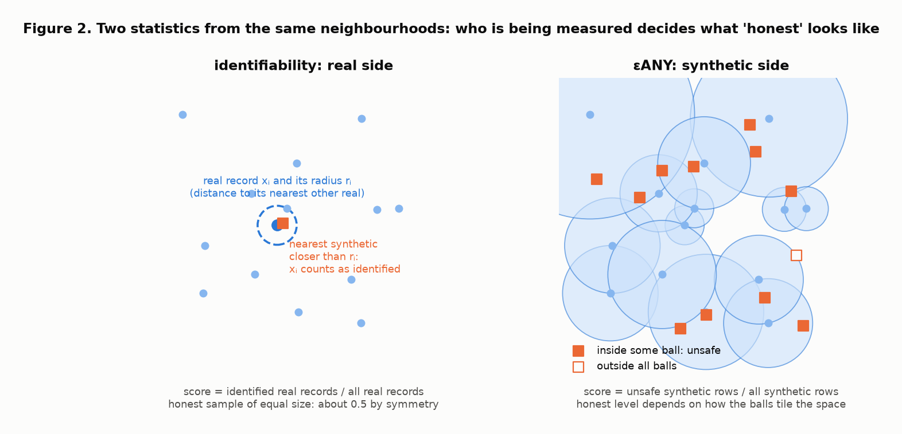
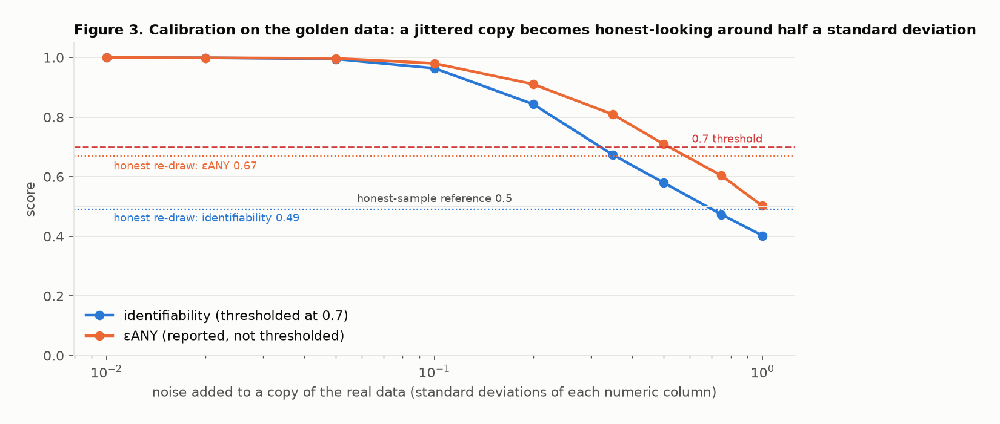
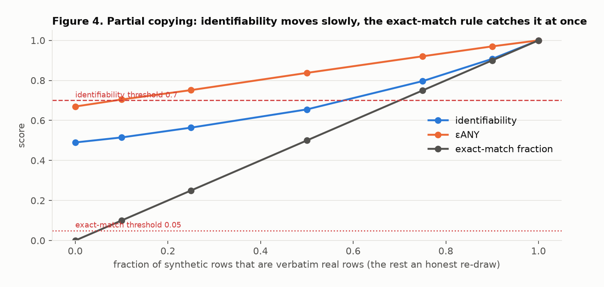
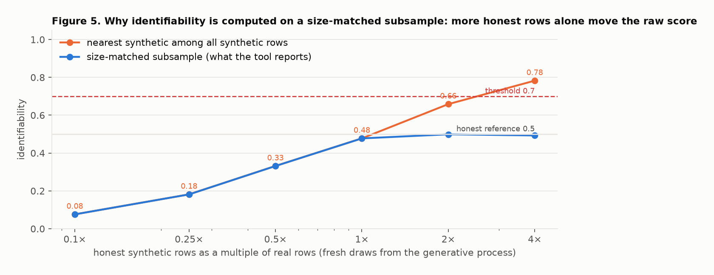

# Measuring disclosure risk: the HEOM identifiability tool, explained

This note explains, from first principles, the privacy tool that phase 4 added to the synthetic-data evaluation agent: what "disclosure risk" means for a synthetic table, how the thesis metric measures it, why the port reports two statistics rather than one, how the agent's threshold was calibrated, and which published results each choice rests on. It is the companion to [eval_harness.md](eval_harness.md), [run_logging.md](run_logging.md) and [service_and_deployment.md](service_and_deployment.md); the code walkthrough for this phase is [privacy_tool_code_walkthrough.md](privacy_tool_code_walkthrough.md).

Every data figure is computed from the golden real data by [figures/make_privacy_figures.py](figures/make_privacy_figures.py) with the real tool (`make figures`, no API key). Citations are given inline as [n] and listed at the end.

**The design in one paragraph.** Both tables are turned into vectors in HEOM space, where a numeric difference counts its fraction of the real range and a category mismatch counts one. Nearest neighbours then give two statistics. *Identifiability* is the fraction of real records whose nearest synthetic record is closer than their nearest other real record; for an honest sample of the same size it sits near 0.5 by symmetry, and a copy scores 1.0. *εANY* is the thesis filter statistic, the fraction of synthetic rows that fall inside some real record's 2-nearest-neighbour ball; a copy scores 1.0 too, but an honest sample already scores about 0.67 here, so it is reported and never thresholded. Exact matches are counted separately. The agent calls the tool only when asked about privacy, calls privacy poor above 0.7 identifiability or 5% exact matches, and lets a poor privacy verdict make the overall verdict poor. Two golden cases pin the behaviour: the exact copy must be poor overall, the honest re-draw must stay excellent.

## 1. Why fidelity and utility are not enough

The eval harness has a case that looks perfect on every axis it measures: the synthetic file is a copy of the real file. Every JS distance is zero, every Cohen's d is zero, and the model trained on it beats the real baseline. The note on the harness said at the time that catching this needs the privacy tool ([eval_harness.md](eval_harness.md), section 3). Here it is.

The failure the tool looks for is memorisation: a generator that reproduces, or nearly reproduces, the records it was trained on. That is the mechanism behind membership inference [1] and training-data extraction [2], and the reason a synthetic release is not automatically an anonymised one: a synthetic table that stays close to its training rows gives an attacker about the same leverage as the rows themselves [3]. The disclosure literature frames the question as record linkage: can a record in the release be linked back to an individual [4, 5]? For a synthetic table there is no one-to-one row mapping, so the question becomes distance: how close do synthetic rows come to real ones, compared with how close real rows come to each other?

This is also a scope statement. The tool measures proximity-based disclosure risk. It does not measure attribute inference, it does not give a differential-privacy guarantee [6], and it is not a certificate. The README and the agent's prompt say "privacy" with that meaning only.

## 2. Distance between mixed-type rows: HEOM

A table has numbers and categories. Euclidean distance does not know what to do with "paris" versus "london", and treating category codes as numbers invents an order that is not there. The Heterogeneous Euclidean-Overlap Metric [7] resolves this per column: a numeric column contributes the difference divided by the column's range, and a categorical column contributes 0 if the values match and 1 if they do not. The per-column contributions combine like Euclidean coordinates. It is a close cousin of Gower's general similarity coefficient [8] and the standard choice for nearest-neighbour work on mixed tables.

The implementation inherits the thesis encoder [9]: numeric columns are min-max scaled with the scaler fitted on the *real* data, so "range" means the real range; each categorical column becomes a one-hot block whose entries are 1/√2, so two different categories are at Euclidean distance exactly 1 and identical ones at 0. A category unseen in the real data becomes an all-zero block, at distance 1/√2 from every real level, which is the thesis behaviour and is noted rather than hidden. After the encoding, plain Euclidean nearest neighbours [10] are HEOM nearest neighbours, and scikit-learn does the rest.

One caveat belongs here. Nearest-neighbour distances lose contrast as dimensionality grows [11]. With seven columns on the golden data that is no issue; with hundreds of one-hot levels it would be, and `exclude_columns` exists partly for that.

## 3. Two statistics from the same neighbourhoods

Both statistics start from the same quantity: for every real record x_i, its radius r_i is the HEOM distance to its k-th nearest other real record, with k = 2 by default, so r_i is simply the distance to its nearest neighbour. The radius says how crowded the real data is around x_i. A synthetic row closer to x_i than r_i is closer than any real record ever gets. The two statistics differ in *whose* fraction is reported.

**Identifiability (real side).** For each real record, is its nearest synthetic record closer than r_i? The score is the fraction of real records for which the answer is yes. This is the identifiability score introduced for ADS-GAN [12], computed here in HEOM space. Its key property is a calibrated reference: if the synthetic set is an honest sample of the same size from the same distribution, then by exchangeability the nearest synthetic point and the nearest real point are equally likely to be the closer one, so the score sits near 0.5. The measured value on the honest control is 0.49. A copy puts a synthetic point at distance 0 from every real record, so the score is 1.0. The same idea, nearest-synthetic versus nearest-real distance compared against a holdout, underlies the holdout-based assessments proposed for mixed-type synthetic data [13].

**εANY (synthetic side).** For each synthetic row, does it fall strictly inside *any* real record's ball? The score is the fraction of synthetic rows that do. This is the thesis statistic, used there as the rejection criterion in the εANY filter with a threshold τANY [9]. It is a stricter, union-of-balls test, and that is why its honest level is high: two thousand balls of nearest-neighbour radius tile a good part of the space, and a fresh point lands inside one of them about two-thirds of the time. The level depends on the data's density and dimension, so no single threshold transfers between datasets. In the thesis εANY is a dial on a filter, where that is fine; as a verdict it would be arbitrary. The port reports it, the prompt forbids thresholding it, and the golden control checks that the model obeys.

**Exact matches.** A third count, independent of radii: synthetic rows at HEOM distance zero from some real row. It catches the one thing identifiability can be slow to see, a partial copy (section 4), and it is what a reviewer asks about first.

Why ship two statistics instead of picking one: because they answer two questions. Identifiability asks "are real records exposed?" and has a reference level. εANY asks "how many synthetic rows are suspiciously close?" and is the thesis's own number, comparable with its published sweeps. The report gives both; only the one with a reference is a rule.

## 4. Calibration on the golden data

Figure 3 takes a copy of the real data and adds Gaussian noise to the three numeric columns, in units of each column's standard deviation. Three readings:

- With one or two hundredths of a standard deviation of noise the copy is still a copy: identifiability 1.0. Exact matches have vanished, though, which is why exact matches alone are not a privacy test.
- Identifiability crosses the 0.7 threshold between 0.2 and 0.35 standard deviations of noise, and reaches the honest level near half a standard deviation. That is the calibration of the threshold: it flags a copy that has been perturbed by less than about a third of the data's own spread.
- εANY runs higher at every noise level and only approaches its honest level of 0.67 near one standard deviation. Read against a 0.7 threshold it would call the honest control borderline, which is the concrete reason it is not thresholded.

Figure 4 mixes verbatim real rows into an honest re-draw. Identifiability rises slowly, because a real record whose copy is absent is not identified; at half the rows copied it is 0.66, just under the threshold. The exact-match fraction is linear by construction and crosses its 0.05 rule at 5% copying. Together the two rules catch a near-copy (identifiability) and a partial copy (exact matches); either alone misses one of them.

Figure 5 is the reason for one implementation detail. With more synthetic rows than real ones, the nearest synthetic point to any real record gets closer simply because there are more candidates. Measured with fresh honest draws from the generative process, the raw score is 0.48 at equal size, 0.66 at twice the real size and 0.78 at four times: an honest sample would cross the threshold on size alone. The tool therefore computes identifiability on a seeded random subsample of the synthetic set the size of the real set, which keeps the reference near 0.5 at every ratio above one. With *fewer* synthetic rows the reference drops below 0.5 (0.33 at half the size, 0.08 at a tenth), and the report says how many rows were used, so a reader can see when that applies.

## 5. What the agent does with it

The tool is the fourth entry in the agent's tool list, but the prompt tells the model to call it only when the request asks about privacy, disclosure risk, re-identification, memorisation or copying. Two reasons: a tool call costs time and tokens, and a privacy verdict should appear only when someone asked the question, so that "excellent" on a fidelity-only request is not mistaken for a privacy clearance.

The verdict rules gain one axis and one change. Privacy, when assessed, is poor if identifiability exceeds 0.7 or the exact-match fraction exceeds 0.05. Overall is poor when utility *or* privacy is poor; the rest is unchanged. The prompt gives the model the 0.5 reference and the reason εANY is not thresholded, so a report can explain the number instead of only quoting it.

The eval harness enforces the "only when asked" rule from both sides. `derive_expected` produces a privacy axis only when it is given a privacy result; `check_verdict` fails a report that includes a privacy verdict on a case that did not ask for one, and a report that omits it on a case that did; the tool-sequence check treats the privacy tool as unexpected on a non-privacy case.

## 6. The two new golden cases

| case | files | prompt | expected |
|---|---|---|---|
| `identical_privacy` | the copy | asks for privacy | identifiability 1.0, exact matches 100%: privacy poor, overall poor, despite perfect fidelity and utility |
| `clean_privacy` | the honest re-draw | asks for privacy | identifiability 0.49, no exact matches: privacy good, overall excellent, and εANY of 0.67 must not be called a problem |

The first is the spec's requirement, "synthetic = exact copy of real must be flagged as maximum disclosure risk". The second is the control without which the first proves nothing: a rule that flags the copy is only useful if it clears an honest sample. The consistency test in the regression suite applies the threshold rules to real tool output on both and asserts they agree with the hand-written keys.

## 7. What the live runs showed

On 2026-10-21 the two privacy cases and the non-privacy `clean_synthetic` control were run twice each on two models, with the Opus judge.

| model | runs | all three checks | privacy tool called when asked | privacy tool called when not asked | clarity (1–5) |
|---|---|---|---|---|---|
| claude-haiku-5-5 | 6 | 6/6 | 4/4 | 0/2 | 4.50 |
| claude-sonnet-5-5 | 6 | 6/6 | 4/4 | 0/2 | 4.67 |

Both models called the copy poor overall and the honest control excellent, quoted εANY as supporting evidence without thresholding it, and produced the privacy key only when asked. Sonnet's copy report added, unprompted, that the identical case's negative utility gap "is suspicious rather than a real improvement" and consistent with memorised rows: the caveat the harness note had said a privacy tool was needed for. Twelve runs put the noise floor at about ±29 points, so this is a smoke test of the integration, not a measurement of the models.

## 8. Limitations and next steps

- **Proximity only.** No attribute-inference attack, no linkage attack with auxiliary data, no formal guarantee. The thesis pipeline has those evaluations; this agent has the first and cheapest one.
- **Threshold calibrated on one dataset.** 0.7 was chosen from Figure 3 on seven-column synthetic data. It is a prompt constant and should be re-read on real data before anyone relies on it.
- **Dimensionality.** With many one-hot levels the distances lose contrast; `exclude_columns` and a lower k are the available levers, not a fix.
- **Unseen categories at 1/√2.** Inherited from the thesis encoder for comparability; a stricter choice would be 1.
- **Quadratic worst case.** The ANY rule queries all real balls at the largest radius; with a single far outlier that radius is large and the query degenerates. Fine at thousands of rows, the thesis used FAISS variants beyond that.
- **No duplicates handling.** Duplicate real rows give r_i = 0 and are never "inside"; exact matches still count them, which is the right fallback but worth knowing.

## Glossary

- **Disclosure risk:** the chance that a released record can be linked to, or reveals, a real individual.
- **Memorisation:** a generator reproducing training records, exactly or nearly.
- **HEOM:** Heterogeneous Euclidean-Overlap Metric; range-normalised difference for numbers, match/mismatch for categories.
- **Radius r_i:** the HEOM distance from real record i to its k-th nearest other real record (k = 2: its nearest neighbour).
- **Identifiability:** fraction of real records whose nearest synthetic record is closer than r_i; honest equal-size sample ≈ 0.5, copy = 1.0.
- **εANY:** fraction of synthetic rows strictly inside at least one real ball; the thesis filter statistic; honest level high and data-dependent.
- **Exact match:** a synthetic row at HEOM distance zero from some real row.
- **Size-matched subsample:** the synthetic rows used for identifiability, drawn to the real size so the 0.5 reference holds.
- **τANY:** the threshold the thesis filter applies to εANY when rejecting and replacing synthetic rows.

## References

1. Shokri, R., Stronati, M., Song, C., & Shmatikov, V. (2017). Membership inference attacks against machine learning models. *IEEE Symposium on Security and Privacy 2017*, 3–18.
2. Carlini, N., Liu, C., Erlingsson, Ú., Kos, J., & Song, D. (2019). The secret sharer: Evaluating and testing unintended memorization in neural networks. *USENIX Security 2019*, 267–284.
3. Stadler, T., Oprisanu, B., & Troncoso, C. (2022). Synthetic data – anonymisation groundhog day. *USENIX Security 2022*. arXiv:2011.07018.
4. Sweeney, L. (2002). k-anonymity: A model for protecting privacy. *International Journal of Uncertainty, Fuzziness and Knowledge-Based Systems*, 10(5), 557–570.
5. Narayanan, A., & Shmatikov, V. (2008). Robust de-anonymization of large sparse datasets. *IEEE Symposium on Security and Privacy 2008*, 111–125.
6. Dwork, C. (2006). Differential privacy. *Proceedings of ICALP 2006*, LNCS 4052, 1–12.
7. Wilson, D. R., & Martinez, T. R. (1997). Improved heterogeneous distance functions. *Journal of Artificial Intelligence Research*, 6, 1–34. (HEOM, HVDM.)
8. Gower, J. C. (1971). A general coefficient of similarity and some of its properties. *Biometrics*, 27(4), 857–871.
9. Yavo, D. (2026). *Generating high-quality privacy-preserving synthetic data* (paper under review). arXiv:2602.06390. Code: github.com/dayav/pipeline_synthetic_tabular_data, `src/privacy_sampling/heom.py` and `get_epsilon_heom_any`.
10. Cover, T., & Hart, P. (1967). Nearest neighbor pattern classification. *IEEE Transactions on Information Theory*, 13(1), 21–27.
11. Beyer, K., Goldstein, J., Ramakrishnan, R., & Shaft, U. (1999). When is "nearest neighbor" meaningful? *Proceedings of ICDT 1999*, LNCS 1540, 217–235.
12. Yoon, J., Drumright, L. N., & van der Schaar, M. (2020). Anonymization through data synthesis using generative adversarial networks (ADS-GAN). *IEEE Journal of Biomedical and Health Informatics*, 24(8), 2378–2388. (The identifiability score.)
13. Platzer, M., & Reutterer, T. (2021). Holdout-based empirical assessment of mixed-type synthetic data. *Frontiers in Big Data*, 4, 679939. (Distance to closest record against a holdout.)
14. Park, N., Mohammadi, M., Gorde, K., Jajodia, S., Park, H., & Kim, Y. (2018). Data synthesis based on generative adversarial networks. *Proceedings of the VLDB Endowment*, 11(10), 1071–1083. (Distance to closest record as a privacy measure.)
