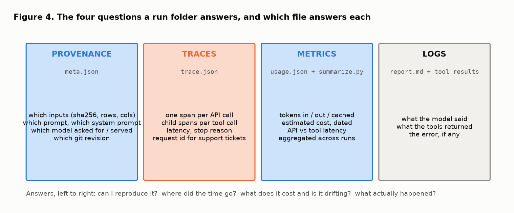
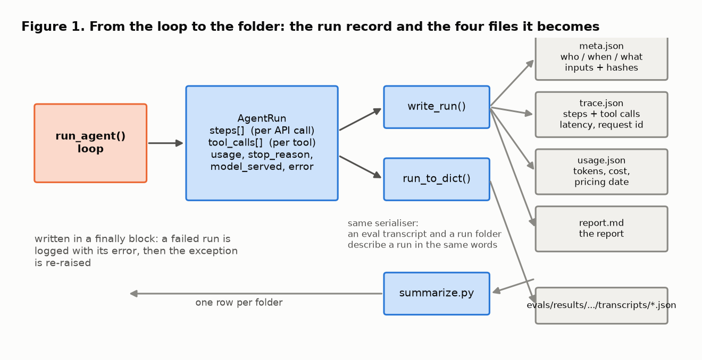
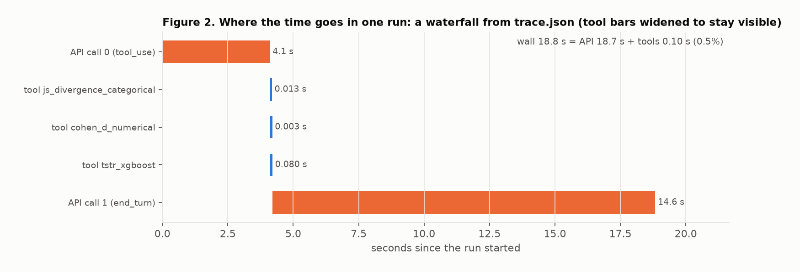
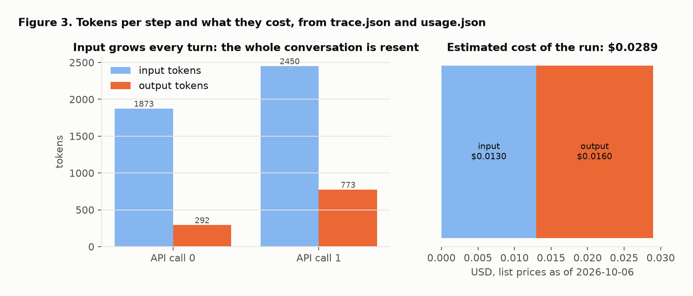

# Logging an agent run: observability for a stochastic, paid computation

This note explains, from first principles, the run logging that phase 2 added to the synthetic-data evaluation agent: why an agent run has to be recorded rather than reproduced, what a run record must contain, which published ideas each design choice rests on, and what the first logged run showed. It is the companion to [eval_harness.md](eval_harness.md), which covers how the agent is *graded*; this one covers how a single run is *remembered*. The code walkthrough is [run_logging_code_walkthrough.md](run_logging_code_walkthrough.md).

Every figure is drawn from the committed example run by [figures/make_runlog_figures.py](figures/make_runlog_figures.py):

```
make figures          # or: python notes/figures/make_runlog_figures.py --run runs/example
```

Citations are given inline as [n] and listed at the end.

**The design in one paragraph.** Every call to `run_agent` produces an `AgentRun`: the report, one record per API call (latency, tokens, cache tokens, request id, stop reason), one record per tool call (arguments, result, latency, which turn asked for it), the model that was asked for and the one that answered, and the error if there was one. Unless told otherwise, the agent writes that record to `runs/<timestamp>_<id>/` as four files: `meta.json` (who, when, what, with the input files hashed), `trace.json` (the steps and their tool calls), `usage.json` (tokens and an estimated cost that names the price list it used) and `report.md`. The folder is written in a `finally` block, so a failed run is logged too. `runs/summarize.py` turns a directory of such folders into one table.

## 1. Why a run has to be recorded

An ordinary function call does not need a log: run it again and you get the same answer. An agent run is three things an ordinary call is not.

- **It is stochastic.** The same prompt yields different text, different tool-call order, sometimes a different number of turns. You cannot reproduce a run; you can only have recorded it. This is the same fact that forced the eval harness to score pass rates instead of asserting outputs ([eval_harness.md](eval_harness.md), section 1).
- **It is distributed.** Part of the work happens in your process (the tools) and part on a remote service (the model). A single wall-clock number tells you nothing about where the time went; you need a timeline with one span per remote call and one per local call. That is the tracing model Google described for Dapper [1] and that OpenTelemetry later standardised [2], now with conventions specific to model calls [3].
- **It is paid for per token.** Cost is not a property of the code; it is a property of each run, and it drifts when the prompt grows, the model changes or a cache stops hitting. Monitoring for exactly this kind of drift is one of the items in the ML production-readiness rubric [4], and the hidden-debt paper lists "undeclared consumers" and "feedback loops" among the reasons such systems degrade quietly [5].

The observability literature groups what you need into logs (what happened), metrics (how much, how long, how often) and traces (in what order, where) [6]. For a reproducibility story you need a fourth thing, provenance: which inputs, which prompt, which model, which code [7, 8]. Figure 4 maps the four to the four files.



## 2. The run record



The loop in [../src/agent.py](../src/agent.py) already returned an `AgentRun` for the eval harness. Phase 2 makes it a complete record of the run:

| field | what it holds | why |
|---|---|---|
| `steps[]` | one `ApiStep` per API call: turn, latency, input and output tokens, cache read and write tokens, stop reason, request id, how many tool calls it asked for | the trace; the unit of cost and latency |
| `tool_calls[]` | name, arguments, result, error flag, latency, the turn that asked | the local half of the trace; the inputs are recovered from here |
| `usage` | token totals summed over steps | the metric |
| `model_requested`, `model_served` | what you asked for and what answered | silent substitutions become visible |
| `run_id`, `started_at`, `finished_at`, `latency_s` | identity and timing | the row key in the summary table |
| `error` | the exception text, if any | a failed run is still a run |
| `log_dir` | where it was written | so the caller can print it |

The design principle is the one event sourcing states for business systems: record the facts as they happen, derive the summaries later [9, 10]. The trace is the facts. Totals, costs and the summary table are all derived from it and can be recomputed if a price changes or a bug in the summariser is found. Nothing in the loop depends on the log existing; the loop would work with logging turned off, and the eval harness does run it that way.

## 3. Provenance: what went in

`meta.json` answers "could I run this again?". It records the prompt, a hash of the system prompt (the prompt is long and lives in the code; the hash tells you which version), the model asked for and served, the git revision, and for every input file the agent touched: path, size, a SHA-256 digest, row and column counts and the column names.

Two choices to explain:

- **The inputs are recovered from the tool calls, not from the prompt.** The prompt is free text. The tool calls are structured, and they are what the agent actually read. If the agent misread a path, the log shows the path it used, which is the fact you want.
- **Files are hashed, not copied.** A digest is enough to prove that a later run saw the same bytes, which is the reproducibility requirement [8], without the log growing with the data or leaking rows into a folder that may be shared. The row and column counts and column names are copied because they are what you look at first when a run looks odd, and they are small. Note what *is* in the log in clear text: the prompt, the file paths and the column names. If column names are sensitive in your setting, that is the field to redact.

Recording this per run is the per-run analogue of a datasheet for a dataset [11]: not a description of the data in general, but of the exact artefact this computation consumed.

## 4. Traces and latency: where the time went



`trace.json` is a list of API steps, each carrying the tool calls it triggered. The timestamps come from `time.perf_counter()` around each API call and each tool call, so the two kinds of latency are measured separately and `usage.json` reports both sums next to the wall time.

Figure 2 is the example run. It makes three points that no total could:

1. **The tools are not the cost.** Three tool calls took 0.1 s of an 18.8 s run. Optimising the tools would be wasted work; the model is 99.5% of the wall time.
2. **The second call is the slow one.** The first API call decided which tools to call in 4.1 s; the second wrote the report in 14.6 s. Output tokens, not input tokens, are what you pay for in latency.
3. **Parallel tool use happened.** All three tool calls hang off API call 0, so this run took two API round trips, not four. A model that serialises tool calls would show as four API bars, and would be slower and more expensive for the same answer.

Each step also carries the API's request id. That is the handle a support ticket needs, and it is free to record [12].

One run is one sample. Latency is a distribution, and the number that matters for a service is a high percentile, not a mean [13]. The summariser prints per-run figures so that, once there are enough rows, percentiles can be computed from them; it does not pretend to know them from one row.

## 5. Tokens and cost: what it cost, honestly



Token counts are read from each API response and summed, never estimated from text length. The cache fields are kept separately because cached input is priced differently and because a cache that stops hitting is the most common silent cost regression [14].

Cost is then *estimated* by [../src/pricing.py](../src/pricing.py) from a table of list prices, and every estimate carries the date of that table. Three rules keep the number honest:

- **An unknown model is unpriced, not guessed.** `estimate_cost` returns `priced: false` and a note naming the missing model. The summary table shows a dash. A wrong cost is worse than no cost.
- **The table is dated and replaceable.** Prices change; the date in every `usage.json` says which rate card a number rests on, and `PRICING_JSON` points the estimator at another table, for a newer card or partner pricing.
- **Known simplifications are stated.** Long-context tiers (Haiku 5.5 charges more above 100K prompt tokens), volume discounts and batch pricing are not modelled. The note field says "estimate only".

Figure 3 shows the two facts worth knowing about a tool-using agent's bill. Input tokens grow every turn because the whole conversation is resent, so a run's cost grows faster than linearly in its number of turns; and in this run output tokens cost more than input tokens despite being four times fewer, because output is priced five times higher. The practical consequence, which the cost-aware-LLM literature reaches from the other direction [15], is that the cheapest lever is usually fewer turns and shorter reports, not a cheaper model.

## 6. Failures are runs too

The folder is written in a `finally` block. If the API raises, if a tool raises inside the loop, or if the turn budget runs out, the record is written with `status: "error"`, the error text, and whatever steps and tool calls had happened, and only then is the exception re-raised. A monitoring system that only sees successes cannot tell "quiet" from "broken" [4, 5]. The offline test suite exercises this path with a fake client that fails on its second call.

## 7. The summary table

`runs/summarize.py` reads `meta.json`, `usage.json` and the verdict block at the end of `report.md`, and prints one row per folder: model served, status, synthetic file and row count, number of tool calls and turns, wall latency split into API and tool time, tokens in and out, cache reads, estimated cost, and the overall verdict. It depends on nothing in `src/`, so it works on a directory of run folders copied to another machine.

It is a table, not a dashboard, on purpose. Phase 3 will put these runs behind an API and a service; the right place for percentiles, alerts and charts is whatever that service reports to. The folder format is the contract; the table is the smallest useful consumer of it.

## 8. Relation to the eval harness

The eval runner calls `run_agent` with `log_dir=None` and writes its own transcript per run, because it already had a place for them. But it builds the `steps` and `cost` fields of each transcript with the same serialiser the folder writer uses, so a transcript and a run folder say the same things in the same words, and each eval summary now carries an estimated agent cost. The two systems answer different questions: the harness asks "is the agent right?", the run log asks "what did this run do and cost?". They share the record, not the purpose.

## 9. What the example run showed

The committed run under [../runs/example/](../runs/example/) is the agent's default model on the bundled 19-row sample, logged on 2026-10-19.

| wall time | API time | tool time | API calls | tool calls | tokens in / out | estimated cost | verdict |
|---|---|---|---|---|---|---|---|
| 18.8 s | 18.7 s | 0.10 s | 2 | 3 | 4323 / 1065 | 0.0289 USD | acceptable |

What the folder tells you that the report alone does not: the model issued all three tool calls in one turn; 78% of the wall time was the second API call writing the report; the two input files differ (different digests) although they have the same shape; and the run was made at git revision `12f3d91` with the system prompt whose hash starts `3862fa84`. Any of those is the first thing you would want when a later run looks different.

## 10. Limitations and next steps

- **One sample is not a distribution.** Percentiles, alerts and trends need many runs; the summariser gives the rows, not the statistics.
- **Prices are static and simplified.** The table is a snapshot; tiers and discounts are not modelled; the estimate is a lower bound for long Haiku prompts.
- **No export.** The folder format is local. Phase 3 should attach the run id to each API response and either ship the trace to an OpenTelemetry collector or expose the folders behind `GET /runs/{id}`.
- **No redaction policy.** Prompts, paths and column names are logged in clear. That is right for this project and wrong for customer data; the place to add redaction is `input_metadata` and the prompt field.
- **Request ids are recorded but not yet joined.** A future phase could pull server-side usage by request id to reconcile the estimate against the bill.

## Glossary

- **Run:** one call to `run_agent`, from prompt to report, however many API calls it takes.
- **Step:** one API call inside a run. The unit of latency, tokens and cost.
- **Trace:** the ordered list of steps with their tool calls; a timeline.
- **Provenance:** the record of which inputs, prompt, model and code produced a result.
- **Digest (SHA-256):** a fixed-length fingerprint of a file's bytes; equal digests mean equal bytes.
- **Request id:** the identifier the API assigns to one response; the handle for a support query.
- **Cache read / write tokens:** input tokens served from, or written to, the prompt cache; priced differently from ordinary input.
- **Estimated cost:** tokens times a dated list price; not an invoice.
- **Unpriced:** a run whose model is missing from the price table; shown as a dash, never as zero.
- **Event sourcing:** recording facts as they happen and deriving summaries from them later.

## References

1. Sigelman, B. H., Barroso, L. A., Burrows, M., Stephenson, P., Plakal, M., Beaver, D., Jaspan, S., & Shanbhag, C. (2010). Dapper, a large-scale distributed systems tracing infrastructure. Google Technical Report dapper-2010-1.
2. W3C. (2021). Trace Context, Level 1. W3C Recommendation. https://www.w3.org/TR/trace-context/
3. OpenTelemetry Project. Semantic conventions for generative AI systems (living specification). https://opentelemetry.io/docs/specs/semconv/gen-ai/
4. Breck, E., Cai, S., Nielsen, E., Salib, M., & Sculley, D. (2017). The ML test score: A rubric for ML production readiness and technical debt reduction. *IEEE International Conference on Big Data 2017*, 1123–1132.
5. Sculley, D., Holt, G., Golovin, D., Davydov, E., Phillips, T., Ebner, D., Chaudhary, V., Young, M., Crespo, J.-F., & Dennison, D. (2015). Hidden technical debt in machine learning systems. *NeurIPS 2015*, 2503–2511.
6. Sridharan, C. (2018). *Distributed Systems Observability*. O'Reilly Media. (Logs, metrics and traces as the three pillars.)
7. Buneman, P., Khanna, S., & Tan, W.-C. (2001). Why and where: A characterization of data provenance. *Proceedings of ICDT 2001*, 316–330.
8. Pineau, J., Vincent-Lamarre, P., Sinha, K., Larivière, V., Beygelzimer, A., d'Alché-Buc, F., Fox, E., & Larochelle, H. (2021). Improving reproducibility in machine learning research: A report from the NeurIPS 2019 reproducibility program. *Journal of Machine Learning Research*, 22(164), 1–20.
9. Fowler, M. (2005). Event sourcing. martinfowler.com/eaaDev/EventSourcing.html
10. Kreps, J. (2013). The log: What every software engineer should know about real-time data's unifying abstraction. LinkedIn Engineering.
11. Gebru, T., Morgenstern, J., Vecchione, B., Vaughan, J. W., Wallach, H., Daumé III, H., & Crawford, K. (2021). Datasheets for datasets. *Communications of the ACM*, 64(12), 86–92.
12. Anthropic. Claude API reference: the `request-id` response header and the `_request_id` property of SDK responses. https://platform.claude.com/docs
13. Dean, J., & Barroso, L. A. (2013). The tail at scale. *Communications of the ACM*, 56(2), 74–80.
14. Anthropic. Prompt caching: `cache_creation_input_tokens` and `cache_read_input_tokens` in the usage object. https://platform.claude.com/docs
15. Chen, L., Zaharia, M., & Zou, J. (2023). FrugalGPT: How to use large language models while reducing cost and improving performance. arXiv:2305.05176.
16. Anthropic. Pricing. https://platform.claude.com/pricing (the list prices in `src/pricing.py`, as of 2026-10-06).
