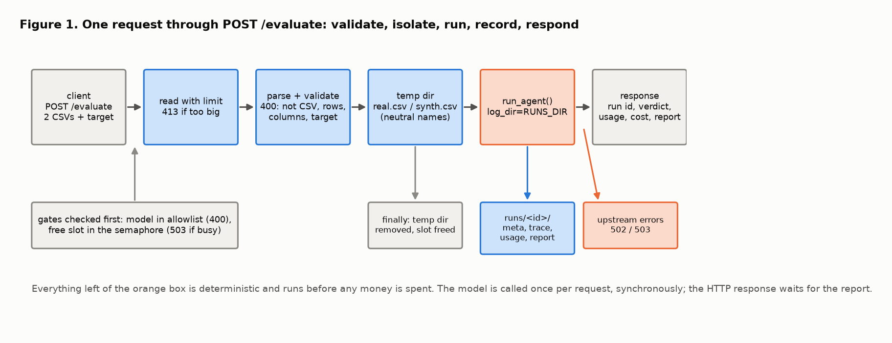
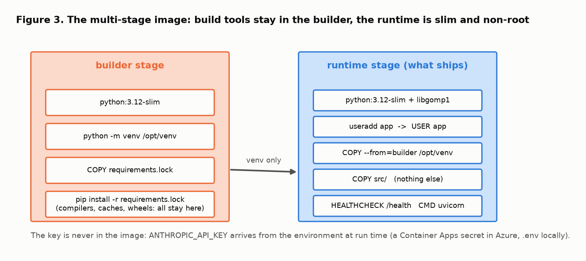
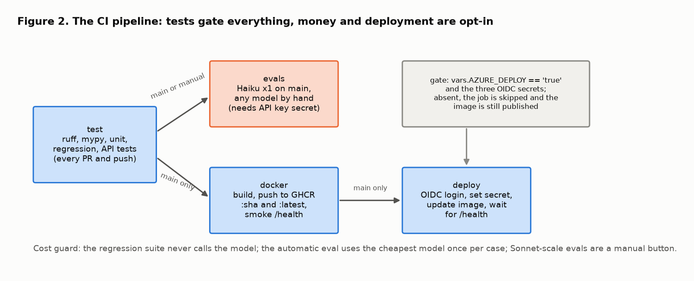
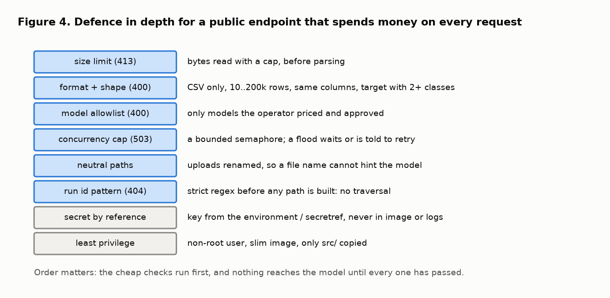

# Serving the agent: the API, the container and the pipeline, explained

This note explains, from first principles, what phase 3 added to the synthetic-data evaluation agent: an HTTP service around it, a container to ship it in, a CI pipeline that gates every change on the regression suite, and the path to a public demo deployment. It covers why each piece is shaped the way it is and which published practice each choice rests on. The companion notes are [eval_harness.md](eval_harness.md) (how the agent is graded) and [run_logging.md](run_logging.md) (how a run is remembered); the code walkthrough for this phase is [service_and_deployment_code_walkthrough.md](service_and_deployment_code_walkthrough.md).

The figures are diagrams drawn by [figures/make_service_figures.py](figures/make_service_figures.py) (`make figures`). Citations are given inline as [n] and listed at the end.

**The design in one paragraph.** A FastAPI app exposes `POST /evaluate` (two CSV uploads and a target column), `GET /runs`, `GET /runs/{id}` and `GET /health`. Every upload is checked before the model is called: size, format, row count, identical columns, a target with at least two classes, a model from an allowlist, and a free slot in a small concurrency cap. The files are saved under neutral names in a temporary directory, the agent runs with run logging on, and the response carries the run id, the parsed verdict, usage, estimated cost and the report. The service runs in a two-stage container that ships only the virtualenv and `src/`, as a non-root user, with a health check. A four-job pipeline tests every change, runs a cheap live eval on `main`, publishes the image, and, when the operator has opted in with a repository variable and OIDC secrets, rolls an Azure Container App. The Azure step is documented command by command and has not been run yet; the README says so.

## 1. Why put an HTTP boundary around an agent

The agent is a Python function. Three things change the moment someone who is not you can call it:

- **Inputs are hostile until proven otherwise.** A file upload is the classic place to get hurt: the wrong format, a huge file, a path that escapes its directory [1, 2]. The function trusted its caller; the service cannot.
- **Every call spends money.** An agent endpoint is an API whose main resource is a paid upstream call. The API security literature has a name for leaving that unbounded: unrestricted resource consumption [3]. Limits on size, rows, concurrency and model choice are the service's budget.
- **The caller cannot see your logs.** A function returns a value; a service must return enough for the caller to act on, and keep enough that the operator can reconstruct what happened. Phase 2 solved the second half; the response schema solves the first.

The boundary also fixes the contract. Pydantic models describe every request and response, and FastAPI turns them into an OpenAPI document [4, 5], so the interface is specified by the same code that enforces it, and `/docs` is always right.

## 2. One request, step by step

The order in Figure 1 is deliberate: the cheap checks come first, the expensive call last, and nothing reaches the model until everything before it has passed.

1. **Gates.** The requested model must be in the allowlist, and a slot must be free in a bounded semaphore. A full semaphore returns 503 immediately rather than queuing; a service that queues unbounded work under load does not degrade, it collapses. This is the bulkhead and fail-fast pattern [6].
2. **Read with a limit.** The upload is read in chunks and rejected with 413 as soon as it exceeds the configured size, before any parsing. Reading everything and then checking the length is how memory runs out.
3. **Parse and validate.** CSV only; at least ten rows (fewer and the 80/20 split in the utility tool has nothing to test on); at most a configured maximum; both files with the same column set; the target present and with at least two classes in both files. Each failure is a 400 with a sentence a human can act on. Validation at the boundary, once, with typed data flowing inward, is the principle usually phrased as "parse, don't validate" [7].
4. **Isolate.** The files are written to a fresh temporary directory as `real.csv` and `synth.csv`. The eval harness learned in phase 1 that the model reads file paths and will cite a directory name as evidence ([eval_harness.md](eval_harness.md), section 6); an upload named `shuffled_income_leak.csv` must not reach the prompt. A test asserts this.
5. **Run and record.** `run_agent` is called with `log_dir` set, so the run folder from phase 2 is written whether the run succeeds or fails. The HTTP response waits for the report: the endpoint is synchronous because a run takes seconds, not minutes, and a job queue would add a state machine the demo does not need.
6. **Respond, and clean up regardless.** The temporary directory is removed and the slot released in a `finally` block. Upstream errors are mapped to status codes that tell the caller what to do: 502 for a rejected key or an API failure, 503 for an upstream rate limit.

## 3. Health and the run routes

`GET /health` returns the version, the default and allowed models, whether a key is configured, where runs are written and whether that directory is writable, and the limits. It is what the container's `HEALTHCHECK`, the CI smoke test and the deploy job poll. A health endpoint that only says "ok" is a liveness check; one that reports the configuration that matters is also the first page of a debugging session [8].

`GET /runs` and `GET /runs/{id}` are a read-only window onto the phase 2 folders. The run id is matched against a strict pattern before any path is built from it, which closes path traversal by construction rather than by sanitising [2]. `?include_trace=true` adds the step-by-step trace for one run.

## 4. The container

The image is built in two stages [9]. The builder installs the pinned dependencies into a virtualenv; compilers, caches and build artefacts never leave it. The runtime stage starts again from `python:3.12-slim`, adds the one system library XGBoost needs, creates an unprivileged user, copies the virtualenv and `src/`, and nothing else. The result is a smaller surface and a container that cannot write to its own code [10].

Three choices worth defending:

- **Pinned versions, in a lock file.** `requirements.lock` holds exact versions; `pyproject.toml` holds the intent. CI and the image install from the lock, so a build on Tuesday and a build on Friday get the same packages. This is the first step towards reproducible builds and a verifiable supply chain [11, 12].
- **Configuration from the environment only.** The API key, the runs directory, the limits and the default model are environment variables. The twelve-factor rule exists so that the same image runs locally with `.env`, in CI with a secret, and in Azure with a `secretref`, without a rebuild and without the key ever being in a layer [13].
- **A health check in the image.** Orchestrators use it to decide readiness and restarts [8]; the pipeline uses it to decide whether a push succeeded.

## 5. The pipeline

Four jobs, and the dependencies between them are the policy:

- **`test` gates everything.** Lint, types, unit tests, the regression suite and the API tests run on every pull request and push, with no API key, in about a minute. Nothing downstream runs if they fail. This is what "regression suite as a CI gate" meant in the plan: the failures recorded in phase 1 cannot silently return [14].
- **`evals` spends money on purpose, and little of it.** On every push to `main` it runs the live harness with the cheapest model, once per case, and the judge; the comparison table lands in the job summary and the full results in an artifact. A manual trigger runs any model with any number of repeats. The regression suite never calls the model, so the only automatic spend is this one small job. If the key secret is absent the job skips with a warning rather than failing the pipeline.
- **`docker` publishes on `main`.** The image is built with layer caching, pushed to GHCR tagged with the commit SHA and `latest`, and the pushed image is started and polled on `/health` before the job passes. Publishing only from `main`, after tests, is the continuous-delivery discipline of a single deployable artefact per green commit [15, 16].
- **`deploy` is opt-in.** It runs only when a repository variable says so and the OIDC secrets exist. It logs in to Azure with a short-lived federated token instead of a stored password [17], updates the container app's secret and image, and waits for `/health` on the public URL. Without the variable, the pipeline still tests and publishes; it simply does not deploy.

## 6. The deployment target, and what is not done

Azure Container Apps was chosen because it runs a container from a public registry with external ingress, scales to zero, and holds secrets natively, all from a handful of `az` commands [18]. [../docs/deploy.md](../docs/deploy.md) gives the exact sequence: resource group, environment, the app with its secret and limits, optional Azure Files persistence for the run folders, the federated credential for GitHub Actions, and the names of every secret and variable the pipeline reads.

What is not done: the Azure resources have not been created, because the build environment has no Azure login. The Dockerfile and the workflow are complete and the image has been built and exercised locally, including an evaluation inside the container. Until the commands in the guide are run, the README says "not yet live" and claims no URL. When it is live it will be called a public demo deployment, with no traffic beyond the author's own, and nothing else.

## 7. Defence in depth, listed

Each layer in Figure 4 is cheap, and each catches something the others do not. None of them is sufficient alone, which is the point of layering [10]. Two are easy to forget and worth saying out loud: the model allowlist means a caller cannot pick the most expensive model on the operator's key; and the neutral file names mean the one thing the eval harness proved the model will exploit, a hint in a path, is removed before the prompt is built.

## 8. What the first requests showed

The service was exercised three ways on 2026-10-20: the API tests with a fake model (thirteen tests, no key), the app under uvicorn with the real key, and the container with the real key.

| where | health | one evaluation (Haiku) | run folder |
|---|---|---|---|
| uvicorn on the host | ok | 6.4 s, 0.001 USD, verdict acceptable, gender flagged | written |
| inside the container | ok; Docker reports healthy | 5.7 s; XGBoost ran in the slim image | written to the mounted volume |

The validation path was also exercised live: a wrong target column returned a 400 naming the available columns. Nothing surprising happened, which for a service boundary is the result you want.

## 9. Limitations and next steps

- **Synchronous evaluation.** A slow model or a large file holds the HTTP connection open. For the demo that is fine; a job queue with a 202 and a status route is the next shape if runs grow.
- **No authentication.** The demo relies on obscurity, limits and a cheap default model. A public endpoint that matters needs a key per caller and a quota.
- **Ephemeral run folders in the cloud.** Without the optional Azure Files mount, a replica that scales to zero loses its runs. The guide has the commands; the README should say which was chosen.
- **The lock file is a snapshot, not a hash-pinned manifest.** Exact versions, no hashes; `pip install --require-hashes` is the next step if supply-chain integrity becomes a requirement [12].
- **One worker.** The container runs a single uvicorn worker; the concurrency cap is per process. Scaling out means more replicas, not more workers, so the cap stays meaningful.

## Glossary

- **Allowlist:** the set of models a caller may request; anything else is refused before the model is called.
- **Bulkhead:** a limit that isolates one kind of work so that overload in it cannot sink everything else; here, the semaphore on evaluations.
- **Fail fast:** refusing work immediately when it cannot be done well, rather than queuing it.
- **Multi-stage build:** a Dockerfile with a build stage and a runtime stage, so build tools never ship.
- **Least privilege:** running with no more rights than the job needs; here, a non-root user and a minimal image.
- **Lock file:** the exact resolved versions of every dependency, as opposed to the version ranges a project declares.
- **OIDC federation:** letting a CI job prove its identity to a cloud with a short-lived token instead of a stored credential.
- **Secret reference:** an environment variable whose value is fetched from a secret store at start, so it never appears in configuration or images.
- **Liveness and readiness:** whether a process is up, and whether it can serve; `/health` answers both for this service.
- **Scale to zero:** a deployment with no running replicas when idle; the first request pays a cold start.

## References

1. OWASP Foundation. File Upload Cheat Sheet. OWASP Cheat Sheet Series. https://cheatsheetseries.owasp.org/cheatsheets/File_Upload_Cheat_Sheet.html
2. MITRE. CWE-22: Improper Limitation of a Pathname to a Restricted Directory ('Path Traversal'). https://cwe.mitre.org/data/definitions/22.html
3. OWASP Foundation. (2023). OWASP API Security Top 10, API4:2023 Unrestricted Resource Consumption. https://owasp.org/API-Security/
4. OpenAPI Initiative. (2021). OpenAPI Specification v3.1.0. https://spec.openapis.org/oas/v3.1.0
5. Fielding, R. T. (2000). *Architectural Styles and the Design of Network-based Software Architectures*. Doctoral dissertation, University of California, Irvine. (REST.)
6. Nygard, M. T. (2018). *Release It! Design and Deploy Production-Ready Software* (2nd ed.). Pragmatic Bookshelf. (Bulkheads, fail fast, timeouts.)
7. King, A. (2019). Parse, don't validate. https://lexi-lambda.github.io/blog/2019/11/05/parse-don-t-validate/
8. Beyer, B., Jones, C., Petoff, J., & Murphy, N. R. (Eds.). (2016). *Site Reliability Engineering: How Google Runs Production Systems*. O'Reilly Media. (Monitoring, health, release engineering.)
9. Docker, Inc. Multi-stage builds. Docker documentation. https://docs.docker.com/build/building/multi-stage/
10. Saltzer, J. H., & Schroeder, M. D. (1975). The protection of information in computer systems. *Proceedings of the IEEE*, 63(9), 1278–1308. (Least privilege, economy of mechanism, defence in depth.)
11. Lamb, C., & Zacchiroli, S. (2022). Reproducible builds: Increasing the integrity of software supply chains. *IEEE Software*, 39(2), 62–70.
12. OpenSSF. Supply-chain Levels for Software Artifacts (SLSA) specification. https://slsa.dev/spec/
13. Wiggins, A. (2011, updated 2017). The Twelve-Factor App. III. Config: Store config in the environment. https://12factor.net/config
14. Breck, E., Cai, S., Nielsen, E., Salib, M., & Sculley, D. (2017). The ML test score: A rubric for ML production readiness and technical debt reduction. *IEEE International Conference on Big Data 2017*, 1123–1132.
15. Humble, J., & Farley, D. (2010). *Continuous Delivery: Reliable Software Releases through Build, Test, and Deployment Automation*. Addison-Wesley.
16. Forsgren, N., Humble, J., & Kim, G. (2018). *Accelerate: The Science of Lean Software and DevOps*. IT Revolution Press.
17. GitHub. About security hardening with OpenID Connect. GitHub Docs. https://docs.github.com/en/actions/security-for-github-actions/security-hardening-your-deployments/about-security-hardening-with-openid-connect
18. Microsoft. Azure Container Apps documentation: secrets, ingress, scaling to zero, GitHub Actions deployment. https://learn.microsoft.com/azure/container-apps/
